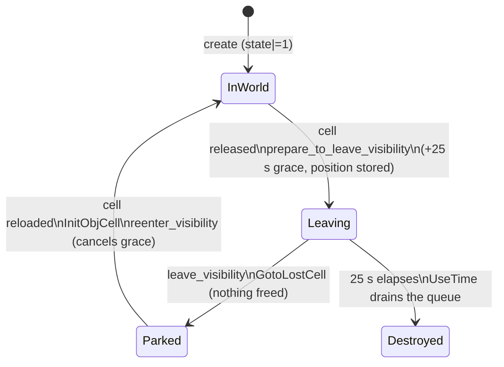

# Retail `acclient` — complete client specification

This document is the complete specification of the **retail Asheron's Call
client** (`acclient.exe`), reconstructed by reverse engineering: REA/Ghidra
analysis of the shipped PE plus systematic mining of the committed Hex-Rays
decompile. It specifies what the retail client *is* — architecture, subsystems,
behaviors, formats, defaults — so that re-implementations (this repo's headless
client and TUI) can be checked against it feature by feature.

Companion documents:

* `docs/PROTOCOL.md` — the byte-exact wire protocol (the contract between this
  client and the server).
* `docs/RETAIL.md` — research notes: how the retail facts were extracted
  (DAT formats, motion tables, verification pins).

Evidence convention: `acclient.c:<line>` cites the committed decompile
(`docs/artifacts/acclient.c`); REA facts cite the PE (sha256 in §1).
`[INFERENCE]` marks behavior inferred from structure rather than read directly.

## 1. Identity

Analyzed binary (the live research rig's game copy, "vintage A" per
`RETAIL.md` §1 — the 2018 re-release; decompiles of the 2019 and 2024 copies
agree on everything that matters):

| field | value |
|-------|-------|
| path | `~/projects/acbot/game/acclient.exe` |
| sha256 | `4c6682f9bdbf716ff83db85d8d8b9888acb84165ae6a4a7413473b37f75cadfa` |
| format | PE32 (i386), GUI subsystem, no exports, no relocation-stripped |
| size | 4,841,472 B |
| image base | `0x400000`, `SizeOfImage 0x56d000` |
| COFF time stamp | 2015-06-12 08:16:44 UTC (re-release packaging; file dated 2018-10-15) |
| compiler | Visual C++ 2003 (imports `MSVCR70`/`MSVCP70`) |
| REA/Ghidra 12.1.4 | 22,590 procedures, 5,746 strings |

Sections (REA `binary_overview`):

| section | VA range | size |
|---------|----------|------|
| `.text` | `0x401000–0x793000` | 3,743,744 |
| `.rdata` | `0x793000–0x80b000` | 491,520 |
| `.data` | `0x80b000–0x9067d4` | 1,030,100 |
| `.data1` | `0x907000–0x909000` | 8,192 |
| `.rsrc` | `0x909000–0x915000` | 49,152 |
| `.reloc` | `0x915000–0x96d000` | 360,448 |

Imports (`objdump -p`): `ADVAPI32`, `USER32`, `KERNEL32`, `RPCRT4`,
`SHELL32`, `IMM32`, `COMCTL32`, `MSVCP70`, `MSVCR70`, `OLEAUT32`,
`VERSION`, `WSOCK32`, `MSACM32`, `WINMM`, `GDI32`, `ole32`, `DSOUND`,
`zlib1`. Two consequences follow and are used throughout this spec:

* **No D3D/OpenGL import** — but the renderer is **Direct3D 9**: `d3d9.dll`
  is loaded *dynamically* (`LoadLibraryA` at acclient.c:456731, HAL device),
  which is why the import table shows no D3D (§14).
* `WSOCK32` + `zlib1` + `DSOUND` — UDP networking, zlib-compressed DAT
  assets, DirectSound audio.

Content vintages visible in strings: this build carries the expansion
content gates ("You must purchase Asheron's Call -- Throne of Destiny to …"),
so it is the full **AC + Dark Majesty + Throne of Destiny** client. Registry
namespace: `Software\Turbine\ac1`. The game directory ships
`theapdll.dll` (Turbine API host), `Keystone.dll`/`KeystoneIMEUI.dll`
(Turbine Keystone — account/billing), `glsclient.dll`, `chatclient.dll`,
`selfpatch.dll`/`patchclient.dll` (self-updater), `corestrings.dll`.

## 2. Architecture

Layered COM-style composition: `ClientMain` (process) → `gmClient` (the AC
game client) → `Client` (base engine) → subsystem singletons. All
line refs are `acclient.c`.

### 2.1 Startup narrative

**`WinMain`** (61051), in order:
1. `Turbine::Debug::Init("ac", &name, 0xE08)` — failure prints "Could not
   initialize Debugging facilities." and returns 1.
2. `ConvertCommandLineToArgList(GetCommandLineA(), …)`.
3. `ClientMain::ConfigureFPU` (60872): `SetFloatingPointException(0,
   0x80017)`; `__control87(0x10000, 0x30000)` (flush-to-zero /
   denormals-as-zero); `__control87(0, 0x300)`; `__control87(0, 0x40000)`.
4. `ProgramTypeSystem::s_eProgramType = 0x40000001`.
5. `IError::AddDataErrorHandlers(0, null)` — installs the global
   data-error handler (see §2.5 logging).
6. `APIManager::Init()` (§2.7 API host).
7. `AC1Legacy::Version::Init(argv0)`.
8. `ACCFactory::Init()`.
9. `ConstructClassObjectEx<Client,Interface>(&Client_ClassType)` —
   COM-style factory via `InterfaceSystem` (success bit `0x80000000`).
10. `vfptr->ParseArgs(args, count, 1)` (virtual slot 0).
11. `vfptr[1](this, "Asheron's Call", 1, 1)` = `gmClient::Init` (63431) →
    `Client::Init`.
12. `ClientMain::ClientCleanUp` (60860) on every exit path.

**`gmClient::Init`** (63431): `Device::ForceDisplayResolution(1, 800, 600)`
(minimum resolution) → `Client::Init` → `UIQueueManager` on
`netQueues_[9]` → `_setlocale(0,"English")` → register for
`GlobalEventHandler` notice **100002 = WorldName** →
`gmClient::InitUIPreferences`.

**`Client::Init`** (78038):
1. `_set_new_handler(portal_new_handler)` (OOM abort).
2. Virtual no-arg = `Client::InitAuth` (77328, overridden by
   `gmClient::InitAuth` 62556) [INFERENCE: vtable slot].
3. `GetVersionExA`; Windows 9x (`dwPlatformId == 1`) → `LoadLibraryA
   ("unicows.dll")` probe; failure → `DisplayString(109, "UnicoWS.dll")`
   and abort (78055–78072).
4. `Timer::Init()`; `Random::Seed()`.
5. `CFactory::MakeGlobalEventHandler()` → `m_eventHandler`.
6. `CFactory::MakeQualityRegistrar()` → `m_qualityRegistrar`.
7. Virtual `vfptr[4](language, region, m_fReadOnlyDatFiles)` =
   `Client::InitDatabase` (78788) [INFERENCE].
8. `CLanguageInfoInterface::Startup()`.
9. Virtual `vfptr[5](windowTitle)` = `Client::InitUI` (77569).

**Auth types** (`gmClient::InitAuth` 62556): `NetAuthenticator::SetToAuthType`
— default type **1** (Empyrean, `Client::InitAuth` 77329); if `m_strVGPassword`
set → type **2** (VG password, serialized via `TransientArchive`); if
`m_strGLSTicket` set → type **0x40000002** (GLS ticket; `0x40000000` flag |
2); else falls through to type 1.

**`Client::InitUI`** (77569) — subsystem creation:
1. `CoInitialize(0)`; `KeyStone::Init()` (Turbine Keystone account layer).
2. `Device::Init(m_fWindowed, title, 800, 600, 1, …)`.
3. `ICIDM::s_cidm->RegisterInputMap(16, …)`.
4. `SoundManager::Init(Device::m_hWnd)` (§14.7).
5. `SmartBox::Init(netQueues_[10], 0)` → `smartbox_`; failure →
   `PopupError("FATAL ERROR: Cannot initialize the render engine!\n")`.
6. `UIElementManager::CreateUIElementManager()` + `Init` (§9).
7. `ConstructClassObjectEx<UIFlow,Interface>` → `m_ui`.
8. `DBObj::InitLoad()` (§14.6).

**`SmartBox::InitInternal`** (146204) — world-system creation order:

| # | System | note |
|---|---|---|
| 1 | `CObjectMaint` | via `InterfaceSystem::CreateInstance`; `testMode` ⇒ `is_active = 0` |
| 2 | `CPhysics` | `CPhysics(objMaint, smartbox)` |
| 3 | `LScape` | landscape manager |
| 4 | `Ambient` | `ambient_sounds` |
| 5 | `RenderDevice::render_device->SetLandscape(lscape)` | |
| 6 | static glue | `CObjCell::SetObjectMaintainer`, `CPhysicsObj::SetObjectMaintainer`, `CWeenieObject::objMaint`, `CObjCell::landscape` |
| 7 | `CFactory::MakeCommandInterpreter()` → `cmdinterp` | registers `SmartBox::smartbox` + autonomy-level handlers |
| 8 | `CellManager` | sets `lscape`, `ambient_sounds` |
| 9 | `CameraManager` | `ICIDM::RegisterInputHandler(4)`, `set_viewer_home`, `hidden = 1` |

`CPlayerModule`/`CPlayerSystem` are **not** created here — they appear at
world entry (see §7).

### 2.2 Frame tick

* `Client::Run` (77630): `err = vfptr[1](&err)` (= `Client::Connect`,
  slot alias [INFERENCE]); if no error: `while (vfptr[2](this));` —
  **vfptr[2] is the per-frame `UseTime`**; loop exits when the tick returns 0
  (quit).
* `gmClient::UseTime` (61245): flushes `m_UIQueueManager` (UI net queue
  `netQueues_[9]`) then `return Client::UseTime(this)`.
* **`Client::UseTime`'s body is absent from the dump** (declared, undefined)
  — the top-level fan-out order (input → net → player → UI → smartbox) is
  [INFERENCE] from the subsystem `UseTime` inventory below.

Observable per-frame fan-out inside `SmartBox::UseTime` (146298):
1. `CellManager`: if `blocking_for_cells` → `CheckPrefetchStatus` only; else
   `CheckPrefetchStatus` (+ `UpdateLoadPoint` if cells pending),
   `ChangePosition(dt, playerPos, 0)` when the player has a cell, set
   `position_update_complete`/`has_been_teleported`.
2. `CObjectMaint::UseTime` (310293) — destruction queue + radar (§4.3).
3. `CPhysics::UseTime` (311412) — drives `MovementManager::UseTime` (339404).
4. If `GameTime::current_game_time`: `GameTime::UseTime` then
   `LScape::UseTime` (307314, which calls `GameSky::UseTime` 308918).
5. `Ambient::UseTime` (384500).
6. `SceneTool::Think()` (§14.3).
7. Drains `in_queue` (render net queue `netQueues_[10]`).

Other per-tick systems (called from the missing `Client::UseTime` / UI flows
[INFERENCE]): `CInputManager_WIN32::UseTime` 673449 (→
`CInputManager::UseTime` 111228, key repeat §11.2), `UIElementManager::UseTime`
153851 (§9.2), `ClientNet::UseTime` 370155 (+ `LogonUseTime` 372280),
`PacketController::UseTime` 368539, `SharedNet::UseTime` 369896,
`DBCache::UseTime` 80086, `DBOCache::UseTime` 83169, `AsyncCache::UseTime`
84138, `CLCache::UseTime` 296031, `CPlayerModule::UseTime` 453093,
`CPlayerSystem::UseTime` 400549, `MoveToManager::UseTime` 346074 (§6.6),
`PositionManager::UseTime` 388251, `StickyManager::UseTime` 388589,
`InterpolationManager::UseTime` 389262, `RecipientData::UseTime` 374286,
plus the per-element `UseTime` group.

### 2.3 Network init & connect

**`Client::InitNet`** (77853): `ClientNet` (0x8CD0 bytes) → `m_net`;
`PacketController` → `packControl_`; `netQueues_ = new[12]`;
`AddNetQueue(2, 10, 9, 4, 5)` (queue IDs; `m_logonEventQueue = netQueues_[4]`);
failure → "FATAL ERROR: Client CANNOT add all of the Net Queues". Called
lazily at connect time (first virtual in `Client::Connect`, [INFERENCE]).

**`Client::Connect`** (78856): InitNet → port selection (`m_clientPort` else
`m_nPreferenceUserSpecifiedPort`) → `ClientNetConfiguration`
(`DesiredInterface = Net_BindInterface`, `bAutoGenerateUniquePort`,
`dwPort`) → wire-logging plugin: `LoadLibraryA("acpl.dll")` else
`LoadLibraryA("pl.dll")`, exports `LogWireDataSent`/`LogWireDataReceived` →
`ClientNet::Init(m_net, host, datver, &m_netAuth, &cfg)`. On success:
`while (m_eLinkState < 3) Client::KeepUIAlive()` — blocks in a UI pump until
link state 3 (connected); failure → `PopupError("Failed to establish
connection to the server: %s")`.

### 2.4 Teardown

* `gmClient::Cleanup` (61594): `DetachUIPreferences()` (the full 28-variable
  preference list, below) → unregister notice 100002 → save changed keymap
  → `ClearKeyMap` → unregister `Input_KeymapFile`/`UI_ChatFontFace`/
  `UI_ChatFontSize` → `Client::Cleanup`.
* `Client::Cleanup` (77508), in order: `CleanupNet` (77951:
  `ClientNet::LogOffServer`, delete packet controller + net, drain all 12
  queues) → `CCommunicationSystem::Cleanup` → `CleanupUI` (77254) →
  `CLanguageInfoInterface::Shutdown` → `CleanupPreferences` (77317) →
  `CleanupDatabase` (77294) → delete quality registrar + event handler →
  `InterfaceSystem` singleton destruction → `SoundManager::Cleanup`.
  (Virtual-slot mapping [INFERENCE].)
* `ClientMain::ClientCleanUp` (60860): per-client virtual cleanup +
  `IUnknown::Release`; `CFactory::CleanUp()`; `AC1Legacy::Version::Cleanup()`.

**`gmClient::DetachUIPreferences`** (61256) is the complete registered
preference variable list: `Sound_SoundDisabled`, `Sound_SoundVolume`,
`Sound_AmbientSoundDisabled`, `Sound_AmbientSoundVolume`,
`Sound_InterfaceSoundDisabled`, `Sound_InterfaceSoundVolume`,
`Sound_SoundFeatures`, `Sound_PlaySoundOnlyWhenActive`; `Misc_TooltipDelay`,
`Misc_TooltipEnable`; `Render_TextureFiltering`,
`Render_BuildingDetailTextures`, `Render_MultiPassAlpha`,
`Render_LandscapeTextureDetail`, `Render_EnvironmentTextureDetail`,
`Render_SceneryDrawDistance`, `Render_LandscapeDrawDistance`,
`Render_ScreenBrightness`; `Display_FullScreen_0`,
`Display_SyncToRefresh_0`, `Display_Resolution_0`;
`Input_MouseLookSensitivity`, `Input_InvertMouseLookYAxis`;
`Camera_AlignToSlope`, `Camera_Stiffness`, `Camera_AdjustmentSpeed`;
`UI_ChatFontFace`, `UI_ChatFontSize`.

### 2.5 Logging / error routing

* `perr << … << endp` → `ErrorStream::output` →
  **`IError::ReportDataError(buffer)`** → the handler installed by
  `IError::AddDataErrorHandlers(0, null)` in WinMain. `operator<<` overloads:
  manipulator fnptr (387912), `const char*` (387950), `IDClass<DataID>`
  (387961).
* No `PLogger` symbol in the dump — whether a structured file logger exists
  beyond `ReportDataError` is unconfirmed [GAP].
* UI-side errors: `PopupError(…)` (e.g. 77589, 78893, 78937).
* FPU exceptions armed in `ConfigureFPU` (§2.1 step 3).

### 2.6 Connection progress model

`LinkStatusHolder::OnNetStatusChange` (77755), `NetStatus` 0–4:

| Status | effect | progress |
|---|---|---|
| 0 | `m_eLinkState = 1` (connecting) | `0.1` (0x3DCCCCCD) |
| 1 | download phase | `Param1·0.5/Param2 + 0.1` → [0.1, 0.6) |
| 2 | verify phase | `Param1·0.03 + 0.6`, clamp `0.9` (0x3F660606) |
| 3 | connected | `1.0`; `m_eLinkState = 3`; `m_errFinal = None`; `m_tLastHeardFromCurServer = cur_time` |
| 4 | fatal | `m_errFinal = *NetError*` (stringID +4, tableID +8); `m_eLinkState = 4` |

`Client::Connect`'s `while (m_eLinkState < 3) KeepUIAlive` consumes states
1/2; state 4 terminates with the `m_errFinal` message.

### 2.7 API host (ACAPI)

`APIManager::Init` (393476): reads the client-options registry value
`"ACPlugin"` (`ClientRegKey::GetClientOptions`); absent → no plugin.
`LoadLibraryA(pluginPath)` → `GetProcAddress(h, "CreateACPlugin")` →
`CreateACPlugin(&pAsheronsCall, &pPlugin)`. **No hardcoded `theapdll.dll`
string in the dump** — the DLL path is entirely registry/user supplied. The
host-side plugin interface `APIManager::IAsheronsCallImpl` (392953+) exposes:
`QueryInterface`, `IssueChatBarCommand`, `SelectItem`,
`Set/Get/GetPreviousSelectedItemID`, `ExamineObject`, `UseObject`/
`UseObjectOn`/`UseEquippedItem`, `ChangeCombatMode`,
`MoveItemExternal`/`MoveItemInternal`, `CastSpell`,
`SetSelectedStackCount`, `DecrementBusyCount`, `IsStandingStill`,
`StopCompletely`, `TurnToHeading`, `SetAutoRun`, + more.
`APIManager::SetUIReady(isReady)` tracks UI readiness.

### 2.8 Preferences / registry machinery

* `GlobalRegistry::GetRegistry` (61211): lazy `0x8100`-byte singleton.
* `UserPreferences::RegisterPreference` (bool 77794 / uint 61678,61715 /
  float 110166 / string 78151) → `GlobalRegistry::RegisterVariableInternal`
  with `GRVDataType_{Bool,Uint,Float,String}`, description, change callback,
  choices; marks the `GRPObject` registered.
* Typed wrappers: `UIPreferenceItemBool`/`Enum`/`Float` (520352+) stored in
  an `IntrusiveHashTable<PString, UIPreferenceItem*>`.
* Registration order: `gmClient::InitPreferences` (62512):
  `Input_KeymapFile` (string), `UI_ChatFontFace`/`UI_ChatFontSize` (uint,
  5 choices each, callback `GRPCallback_OnFontPreferenceChanged` (61290) →
  `CM_UI::SendNotice_FontSettingsChanged`) → `Client::InitPreferences`
  (78140): `UserPreferences::Initialize`/`Load`; `Net_BindInterface`,
  `Net_ComputeUniquePort`, `Net_UserSpecifiedPort`; `CIme::InitPreferences`.
  The UI sound/render/camera/input vars are registered by
  `gmClient::InitUIPreferences` (62897) — inverse of the §2.4 detach list.

### 2.9 Profiler

`ProfilerUI` (516953) is a debug overlay: toolbar + per-category stat
windows (`AddWindow` 518579, `AddBudgetStat` 520109); dedicated memory-
counter, block-resource, DB-object, and memory-probe windows
(519666–519768). `Think` (517897) re-registers input maps on
activate/deactivate (priority 4000, §11.3) and, while active, refreshes
`m_nGraphicsQualityLevel = Render::DetermineOverallGraphicsQuality`.

### 2.10 Gaps

* `Client::UseTime` body absent — top-level frame fan-out [INFERENCE].
* `CPlayerModule`/`CPlayerSystem` creation sites (§7).
* Virtual-slot → function mappings marked [INFERENCE] rely on signature
  matching (no vtable dump).

## 3. Networking

The transport is raw UDP over `WSOCK32`, one socket for both directions.
Byte-exact wire formats (framing, checksums, opcodes, login recipe, ISAAC)
are in **PROTOCOL.md** — this section is the client-side implementation.

### 3.1 Socket / UDP setup

`ClientNet::InitAddresses` (372327):

* Host string split on `","` and `":"`; default port constant **7304**
  (the AC login port base; game servers use 9000 — PROTOCOL.md §5).
* `socket(AF_INET, SOCK_DGRAM, 0)`; **one socket** used for both directions
  (`m_sockRead` and +16 set to the same SOCKET).
* Bind `0.0.0.0`; if `bAutoGenerateUniquePort` → start port =
  `htonl(localIP) % 0xFA07`, scan up in steps of **256** while ≥ 1024 until
  `bind` succeeds; else `bind(Config->dwPort)`.
* **Receive buffer raise loop**: `getsockopt(SO_RCVBUF)`; target
  `0x20000` (**128 KiB**); repeatedly `setsockopt((cur + 0x20000)/2 +
  (cur+0x20000)%2)` and re-read until achieved or refused.
* `ioctlsocket(FIONBIO, 1)` → **non-blocking**.

Receiver table: `receivers_[1064]` of 136-byte `ReceiverData`
(`136 * recID`, 372840). `PacketController` (7662) is the global send/recv
pump (`AddRecipient`/`GetRecipient`/`DeleteRecipient`).

### 3.2 Datagram framing

Datagram = 20-byte header + optional headers + fragments (PROTOCOL.md
§2.1/§2.3). Client field names in `ProtoHeader`: `seqID_`, `header_`
(flags), `checksum_`, `recID_`, `datalen_`, `iteration_`, `interval_`.

**Receive** — `ClientNet::ProcessPacket` (372673) →
`SharedNet::ProcessPacket` (372121):
1. `VerifyHeader` (370929) — checksum/header validation; drop on failure.
2. `m_pRecv = &receivers_[136*recID]`; `m_pRecip = GetRecipient(recID)`.
3. `seqID_ != 0` → `ProcessNewSeqNum` (NAK/ACK); **`seqID_ == 0` with
   flag `0x2` (EncryptedChecksum) → drop** (zero-seq packets must be plain).
4. `SplitPacketData` → optional headers + blob fragments;
   `m_BytesReceived += size + 20` (**20 again confirms the header size**).
5. Failed split on seq≠0 + EncryptedChecksum →
   `ReceiverData::AddNakked(recv, seqID_, cryptoKey_)` — record consumed
   key + NAK (PROTOCOL.md §4.3 key recovery).

**Send** — `SharedNet::SendPacket` (369234):
`pheader->checksum_ += ChecksumHeader(pheader)` (final
`Checksum = payloadHash + headerHash`); scatter-gather `WSABUF
scatter[91]`: `{pheader, 20}` first, then optional headers, then per
fragment a 16-byte header + `fragSize − 16` data; `wsasend`-style send.

**Optional-header masks** (switch in `ProcessOptionalHeader` 372716 on
`m_dwMask`): `0x100` ServerSwitch → `HandleServerSwitch`; `0x200`
LogonServerAddr → extract `sockaddr_in` into `m_LogonData.ServerAddr`;
`0x800` Referral → `HandleReferral`; `0x40000` ConnectRequest →
`HandleConnectionRequest`; `0x100000` NetError → `LogOffServer` +
`SendNotice_ServerDied` (if no FSM) or `EndState(Reason)`; `0x200000`
NetErrorDisconnect → `NotifyPluginsOfStatusChange(Net_Login/WorldConnection
Error)`; `0x4000000` EchoResponse → `CLinkStatusAverages::OnPingResponse`;
`0x8000000` Flow → consumed; `0x1000000` TimeSync → `HandleTimeSynch`.

Post-processing: a packet from a state-4 (handshake-acked) receiver whose
`0x40000` flag is *not* set → `SetConnectionState(cs_Connected)`; if
`m_LogonData.bMyTurn` → FSM `EndState(None)` (advances login).

### 3.3 C2S: `Event_*` order builders

Canonical pattern (`CM_Communication::Event_Talk` 701340):
1. `OrderHdr hdr; hdr.stamp_ = Proto_UI::GetNextUICounter()`
   (`eventCounter_++ + 1`, 373899).
2. Size = `PStringBase::Pack(msg,0) + OrderHdr::Pack(hdr,0) + 4`.
3. `OrderHdr::Pack` then `u32 GameActionType` then body.
4. `Proto_UI::SendToWeenie(buf, size)`; on failure `UICounterFailedSend()`.

`OrderHdr` (716847): `Pack` writes **`0xF7B1`** (63409, C2S GameAction
wrapper, PROTOCOL.md §7) + `u32 stamp_` (= server's `clientSequence`).

Sample opcodes (LE u32 first dword):

| builder | line | opcode | queue | body |
|---|---|---|---|---|
| `Event_Talk` | 701340 | type 21 | Weenie(3) | String16L msg |
| `Event_TalkDirect` | 701370 | type 50 | Weenie(3) | String16L + u32 target |
| `Event_RequestPing` | 698299 | type 489 | Weenie(3) | — |
| `SendForceObjdesc` | 374055 | **0xF6EA** | Control(2) | u32 object_id |
| `SendEnterWorldRequest` | 374066 | **0xF7B8** | Logon(4) | — |
| `LogOffCharacter` | 374076 | **0xF653** | Logon(4) | u32 gid |
| `SendCharGenResult` | 374098 | **0xF656** | Logon(4) | String16L account + `CharGenResult::Pack` |
| `SendDeleteCharacter` | 374128 | **0xF655** | Logon(4) | String16L account + u32 slot |
| `SendEnterWorld` | 374153 | **0xF657** | Logon(4) | u32 gid + String16L account |
| `SendAdminGetServerVersion` | 374087 | **0xF7BC** | Control(2) | — |

Queue senders: `SendToWeenie` (3) / `SendToControl` (2) / `SendToLogon`
(4) / `SendToDatabase` (5). `Proto_UI::SendBlob` (373855): recipient =
default recID except queues **4, 5, 8** → the *other* recID (login/database
bound traffic vs in-game); blob ID flags `0x23000000` for queues 4/5/8
else `0x03000000`; `NetBlob::Send(pBlob, recip, priority=5)`.
`SetEventCounter(ts)` re-syncs the stamp from a server value.

The full `Event_*` inventory spans `CM_Character` (697606–700009),
`CM_Communication` (700682–701421), `CM_Magic`, `CM_Social`,
`CM_Fellowship`, `CM_Allegiance`, `CM_Item`, `CM_House`, `CM_Trade`,
`CM_Game`, `CM_Admin`, `CM_Combat`, `CM_Inventory` (funs.txt 13952–14307).

### 3.4 S2C: receive dispatch

Reassembled message = `u32 opcode + body` → UI queue manager routes by
opcode to static `CM_<Module>::DispatchUI_<Name>(ui, buf, size)` handlers,
each re-checking its opcode, forwarding to `ClientUISystem::Handle_*` or
posting a notice. Sampled:

* `CM_Login::DispatchUI_WorldInfo` (710814) — opcode **0xF7E1**
  (ServerName/world info), reads 2×u32 + String16L world name →
  `ClientUISystem::Handle_Login__WorldInfo`.
* `CM_Character::DispatchUI_EnterGame_ServerReady` (697581),
  `DispatchUI_ReturnPing` (697594), `DispatchUI_ConfirmationRequest`
  (699696), `DispatchUI_QueryAgeResponse` (699746).
* `CM_Communication::DispatchUI_HearSpeech` (701802), `HearDirectSpeech`
  (701556), `HearEmote` (701620), `HearRangedSpeech` (701676),
  `HearSoulEmote` (701746), `ChannelBroadcast` (701496), `PopUpString`
  (701864), `TextboxString` (701911), `TransientString` (701959),
  `WeenieError` (700669), `WeenieErrorWithString` (702006).
* `CM_Item::DispatchUI_AppraiseDone` (705203); `CM_Trade::DispatchUI_Recv_*`
  (710119–710242); `CM_House::DispatchUI_Recv_*` (707358–708532);
  `CM_Combat::DispatchUI_QueryHealthResponse` (706673);
  `CM_Inventory::DispatchUI_Recv_SalvageOperationsResultData` (709634);
  plus `CM_Magic` (699806–700633), `CM_Game`, `CM_Fellowship`,
  `CM_Allegiance`, `CM_Admin` (710864–711148), `CM_Social` ranges.
* **Smartbox queue**: `ACSmartBox::DispatchSmartBoxEvent` (392710) —
  world-stream messages (PlayerCreate 0xF746, ObjectCreate 0xF745,
  UpdatePosition 0xF748, VectorUpdate 0xF74E, Motion 0xF74C, ObjectDelete
  0xF747, PROTOCOL.md §11) dispatch only once preceding objects in the box
  are present.
* **Notices** (event fan-out, not queue messages): `ECM_Login::
  SendNotice_ServerDied` (682424), `SendNotice_CharacterError` (682398),
  `SendNotice_WorldName` (682450); `CM_Login::SendNotice_BeginEnterWorld`
  (710788); and the `RecvNotice_*` fan-out into UI classes (§10).

The opcode→handler table itself is unnamed in the decompilation —
registration [INFERENCE] static per module; evidence is the opcode
re-check inside each handler.

### 3.5 Retransmission, timeouts, heartbeat

* **Connect-ack retransmit**: state 4 → if `local_time − lastSentHandshake
  > 0.3333 s` → resend `SendConnectAck` (372886).
* **NAK/PAK flow control**: connected → if `m_SeqIDsWeNAKed._currNum` →
  `EnqueueNaks`, else `EnqueuePak` (372914). PAK/NAK body =
  `CSeqIDListHeader<8192,33>` = `{u32 count, u32 seqIDs[count]}`. Inbound
  PAK pops listed seqIDs from the receiver's outstanding AVL table
  (`receivers_[136*recID + 76]`, 372213); inbound NAKs →
  `RecipientData::ProcessNaks` (374408, retransmit via `FlowQueue`).
* **2-second heartbeat / link status**: for `currServerRecID_` every ≥ 2.0 s
  → fill `m_CurrentLinkStatus` (RoundTripDelay, TimeSinceLastGotData,
  SnapshotDuration), `CLinkStatusAverages::AddSnapshot`,
  `NotifyPluginsOfHeartbeat`.
* **140-second no-data timeout**: `m_LocalTimeLastGotData` older than 140 s
  → `SetConnectionState(cs_DisconnectReceived)`; if old state was
  connected and the receiver carries a referral cookie → rebuild
  `COnePrimHeader<2048, 0x40000002, CReferralStruct>` (mask 0x800) and
  re-queue the referral so the session can be re-established on the new
  server (372934–372967).
* **Ping**: C2S `Event_RequestPing` (type 489) → S2C `DispatchUI_ReturnPing`;
  header-level `EchoRequest` 0x2000000 / `EchoResponse` 0x4000000 →
  `CLinkStatusAverages::OnPingResponse`.
* **Time sync + speedhack guard** (`HandleTimeSynch` 371534): server f64
  time; if `srvtime + 60.0 >= now` reset the drift accumulator; else
  accumulate — after > 60 s of drift → enqueue
  `NetError ID_ConnectionError_RunningSpeedhack` and drop.
* **Server switch** (`HandleServerSwitch` 371575): type 0 = world, 1 =
  logon; monotonic stamp check; world switch sets `currServerRecID_` +
  `netID_`, logon switch sets `logonRecID_`.
* **Referrals** (`HandleReferral` 373367): validates `idServer < 0x100`;
  attaches `qwCookie` to an existing receiver or enqueues
  `CReferralQueueEntry {Addr, qwCookie, nAuthsSent, idServer}` (20 bytes);
  `ProcessReferralQueue` (371810) drives the world-auth sends.

### 3.6 Login handshake / enter-world / logout

| # | dir | client fn (line) | wire detail |
|---|---|---|---|
| 0 | setup | `ClientNet::Init`/`InitAddresses` | UDP socket, bind, 128 KiB raise, non-blocking (PROTOCOL.md §5 step 0) |
| 1 | C2S | `SendLoginRequest` (371680) | `CLogonHeader::CreateFromData("1802", pNetAuth)` — version literal **"1802"** (371705); flags `1|2|4` set, `8|0x10` clear; `ProtoHeader` seqID=0, recID=0, `header_=0x10000`, plain checksum → `:9000` (PROTOCOL.md §5 step 1) |
| 2 | S2C | `HandleConnectionRequest` (373233) | mask 0x40000; generation check on `iteration_`; `NetKeyExch` (24 B) over `PortalDH` + `SetPrivateRandom(vlong(10))`; `ReceiverData::Init(…, OutgoingSeed, IncomingSeed)`; `PacketController::AddRecipient`; first connection = both `logonRecID_` + `currServerRecID_`; state → 4; `SendConnectAck`. Body = f64 serverTime, u64 cookie, u32 clientId, u32 Out/IncomingSeed, u32 pad (PROTOCOL.md §5 step 2) |
| 3 | C2S | `SendConnectAck` (371747) | optional header mask `0x80000`, `cbData = 8`, payload = **8-byte referral cookie echoed**; sent to **port+1 (9001)**; plain checksum (unverified server-side); retried every 0.333 s |
| 4 | S2C | `ProcessPacket` (372689) | first non-ConnectRequest → `cs_Connected`; `bMyTurn` → FSM `EndState(None)` |
| 5 | S2C | `DispatchUI_WorldInfo` + login UI | encrypted bundle: CharacterList 0xF658 + ServerName 0xF7E1 (UI queue), DDD_Interrogation 0xF7E5 (database queue) (PROTOCOL.md §5 step 5, §8) |
| 6 | C2S | `SendEnterWorld(gid, account)` (374153) | **0xF657** + u32 gid + String16L account, Logon(4) (related: `SendEnterWorldRequest` 0xF7B8; char-gen 0xF656; delete 0xF655) |
| 7 | S2C/C2S | world referral: `HandleReferral` → `ProcessReferralQueue` → world `ConnectRequest` → `HandleServerSwitch` sets `currServerRecID_`/`netID_` | |
| 8 | S2C | `DispatchUI_EnterGame_ServerReady` (697581); `SendNotice_BeginEnterWorld` (710788); `gmCharacterManagementUI::RecvNotice_BeginEnterWorld` | in-world; `CPlayerSystem::SendLoginCompleteNotification` (400403) completes the session |

**Logout**: UI/`CPlayerSystem` (`ExecuteLogOff` 395847,
`RequestLogOff` 400378, `LogOffCharacter(immediate)` 400738; UI notice
`gmGamePlayUI::RecvNotice_Logoff` 280828) → `Proto_UI::LogOffCharacter(gid)`
**0xF653** (374076) → `ClientNet::LogOffServer` (371644): optional header
mask `0x8000` (Disconnect), `Flags = 3`, **broadcast to every connection**
via `SendOptionalHeader`; sets `logOffSent_`, `logonRecID_ = 0`,
`ExitWorldDisconnect`. Same path fires on unexpected connection death.

### 3.7 Encryption (ISAAC / CryptoSystem)

* `CryptoSystem` (ctor 630226): `pGenerator_ = new QTIsaac<8, unsigned
  long>(seed, seed, seed)` — **Qt-ISAAC**, algorithm verified against
  PROTOCOL.md §6 (128-round scramble, `randmem`/`randrsl` 256×u32,
  `b = mm[(y>>10)&0xFF] + x` pattern visible at 630323).
* `GetNextCryptoSeed` (630420): `lastIter_++`; pop `randrsl[--randcnt]`;
  on empty → `isaac()`, `randcnt = 255`, return `randrsl[255]` (consumed
  from the tail — PROTOCOL.md §6.4 `Next()`).
* `EncryptData` (630446): **XORs each 4-byte chunk of `data` with one
  stream key** (whole dwords only); one key per packet (PROTOCOL.md §6.5).
* Per-connection wiring: `ReceiverData::Encrypt` (376230) →
  `cryptoOutgoing_` (C2S); `Decrypt` (376236) → `cryptoIncoming_` (S2C);
  `InitCrypto(seedIn, seedOut)` (376272) builds both from the two seeds in
  the ConnectRequest.
* **Checksum encryption** (`FlowQueue::EncryptChecksum` 374455): the 4-byte
  `checksum_` is XORed with the key; sets `flags_ |= 1` and stashes
  `cryptoKey_` (server later `Search`/`ConsumeKey`s it — PROTOCOL.md
  §4.3: `Checksum = headerHash + (payloadHash ^ key)`).
* **DH**: `NetKeyExch` (ctor 377147, `Pack` 377104, `UnPack` 377127,
  `SetPrivateRandom` 377094) over `PortalDH` — public-key material carried
  in the login handshake (`CLogonHeader` 469263, `CConnectHeader`
  468671; bodies not mined).

### 3.8 Gaps

* `SharedNet::ProcessOptionalHeaders` / `SendOptionalHeader` /
  `ProcessNewSeqNum` / `SplitPacketData` / `ProcessBlobFrags` /
  `ChecksumHeader` bodies not read.
* `VerifyHeader`, `SendBuff`, `ProcessReferralQueue` internals, FSM
  `EndState`/`OnStateBegun` states not read.
* `NetAuthenticator` (account/password block) and `NetKeyExch` wire
  encodings not read; `QTIsaac::randinit` seed-init (first 4 bytes) not
  verified in client code.
* Character-list 0xF658 handler not located; opcode→DispatchUI table
  registration site unnamed.

## 4. World streaming (cells, objects, visibility)

The world streams around the player in two grids: an **env (landscape) grid**
of 8 u cells and **object cells** of 24 u. Object cells with low-16 bits
`< 0x100` are *land cells* (pure memory); `>= 0x100` are *pack cells* loaded
lazily from the cell `.dat` via `DBObj` (`CObjCell::Get`, acclient.c:346787).
The landblock id is the cell id's high bits (RETAIL.md §2.2).

### 4.1 Constants

| Constant | Value | Source |
|---|---|---|
| `mid_radius` (streaming radius / landscape draw distance) | **8** | acclient.c:45606 |
| Detail presets (low→ultra) | 3 / 5 / 8 / 11 / 15 | 378755–378795 |
| Env cell size | 8 u (coord `>> 3`) | 307576–307577 |
| Grid width `mid_width` | `2r+1` → 17 at default | 306530 |
| `block_draw_list` | `4·mid_width²` pointers | 306576 |
| Object destruction grace | `cur_time + 25.0` s | 310744 |
| Queue/table timestamp match tolerance | `fabs(diff) < 2e-4` | 310355 |
| Null-object forced objdesc re-request | > 20.0 s idle | 310389, 310437 |
| Radar (visible-list) update interval | > 1.0 s | 310326 |
| Remote-actor interpolation stop distance | ≥ 96.0 u | 323566 |

### 4.2 SmartBox (the streaming grid)

`SmartBox` owns the env grid + object-cell streaming:

* `set_mid_radius` (144300): saves `cell_manager->blocking_for_cells`,
  `CellManager::Reset`, `LScape::SetMidRadius`; on success re-runs
  `CellManager::ChangePosition` if it was previously blocking. The global
  `mid_radius` is re-applied whenever the `Render_LandscapeDrawDistance`
  preference differs from it (381008–381036).
* `SetRegion` (144336): hard reset on world/area change — `CellManager::Reset`
  + `CRegionDesc::SetRegion` + `LScape::ChangeRegion` + re-apply radius.
* `PlayerPositionUpdated` (144737): the per-move entry. The teleport branch
  clears `position_update_complete`/`waiting_for_teleport`/
  `has_been_teleported` + the teleport hook; the walk branch recenters only
  when `distance_moved > GetAutonomyBlipDistance`, then **always** (if the
  player has a cell id) calls `CellManager::ChangePosition(pos, teleporting)`
  (144770) — the grid recenter + acquire/release driver.
* `update_viewer` (145033): camera/viewer placement — re-enters visibility if
  the player has no cell, computes the camera target from the viewer sphere,
  runs a `CTransition` path (speed 92, 145128), falling back through
  `AdjustPosition` to a hard snap to the player position.

### 4.3 CObjectMaint (object tables, destruction queue)

Tables (ctor 310098): `object_table`, `weenie_object_table`,
`null_object_table`, `null_weenie_object_table`, `object_inventory_table`
(intrusive hashes keyed `id ^ (id >> shift)`), `lost_cell_table` (keyed by
cell id), and `destruction_object_table` + `object_destruction_queue`
(min-heap keyed by destruction timestamp).

* **Create** — `ACCObjectMaint::CreateObject` (391871): reject duplicate id;
  promote a *null* (placeholder) object via `CPhysicsObj::InitNullObject`
  (which also `RemoveObjectToBeDestroyed`), or `CPhysicsObj::makeObject`;
  link the physics↔weenie pair (`set_weenie_obj_ptr`), apply the description
  (`set_description` → `DoObjDescChanges`), set children + parent from the
  description, `AddObject`, then notify the UI.
* **Per-frame tick** — `CObjectMaint::UseTime` (310293), gated on
  `is_active`: (1) radar visible-list update at >1 s cadence; (2) drain the
  destruction queue — take the min key, stop at `key >= cur_time`, require the
  `2e-4` timestamp match, then virtual-delete; (3) null-table sweep — every
  placeholder idle >20 s gets `Proto_UI::SendForceObjdesc(iid)` to re-request
  the real description.
* **`AddObjectToBeDestroyed`** (310729): erase any existing entry, schedule
  `destruction_time = cur_time + 25.0`, insert into table + queue. **The
  25 s leave-visibility grace.**

### 4.4 Cell lifecycle + visibility state machine



* `prepare_to_leave_visibility` (319276): remove shadows, `leave_cell(0)`,
  `AddObjectToBeDestroyed(self)` **and every child** → starts the 25 s grace.
* `leave_visibility` (321495): `prepare_to_leave_visibility` →
  `store_position` (**position kept**) → `GotoLostCell` → clear
  `transient_state & 0x80`. The object now lives only in `lost_cell_table`.
* `prepare_to_enter_world` (319298): bump `update_time`,
  `RemoveFromLostCell`, `RemoveObjectToBeDestroyed(self + children)` —
  **cancels the pending destruction**; set `transient_state |= 0x80`.
* `reenter_visibility` (323479): `prepare_to_enter_world` → `SetPosition`
  (stored position, flags `0x11`).
* **Acquire**: `CObjCell::init_objects` (346972) →
  `CObjectMaint::InitObjCell` (309849) removes the cell from
  `lost_cell_table` and `reenter_visibility` on every parked object.
* **Release**: `CObjCell::release_objects` (347000) →
  `CObjectMaint::ReleaseObjCell` (309382) collects every object with
  `!(state & 1) && !parent` and calls `leave_visibility` on each.

### 4.5 Landblock / cell transitions

* **Env grid** (`LScape`): `land_blocks[mid_width×mid_width]`, recentered on
  every move via `CellManager::ChangePosition`; `block_draw_list` rebuilt
  from the center; dropped blocks released + zeroed (306480–306504).
* **Discarded** when a pack cell leaves: parts/lights/shadows
  (`release_objects`), the cell's `DBObj` (.dat unload), per-object cell
  registration. **Kept**: the `CPhysicsObj`/`CWeenieObject`, their stored
  position, stats, queued blobs — parked in `lost_cell_table`.
* **Re-entering**: `CObjCell::Get` reloads the .dat → `init_objects` →
  `InitObjCell` → `reenter_visibility` for parked objects →
  `SetPosition(0x11)` back into physics.

### 4.6 Physics registration on enter/leave

`CPhysicsObj::enter_cell` (318282): `CObjCell::add_object` (recursive for
children), set `objcell_id`, `CPartArray::SetCellID` + `AddLightsToCell`.
`leave_cell` (318324): mirror. Per-cell collision geometry:
`AddObjectToSingleCell` (322005) registers one `CShadowObj` +
`CObjCell::add_shadow_object` + `CPartArray::AddPartsShadow`;
`add_shadows_to_cells` (322057) spreads one shadow per overlapping cell.
`MoveOrTeleport` (323534) stops interpolating remote actors once
`player_distance >= 96.0`. The `ClientObjMaintSystem` COM facade (ctor
392056) composes `CObjectMaint` as its first subobject and routes
`UpdateStat`/`RemoveStat`/`Handle_Qualities__*` updates into weenie objects.

## 5. Entities, models, animation

Each in-world object is a pair: `CPhysicsObj` (position, physics, parts,
animation) + `CWeenieObject`/`ACCWeenieObject` (game logic), linked at
creation (`set_weenie_obj_ptr` + `Client::SetPortA`, acclient.c:391925). The
weenie object's `id` **is** the object GUID used throughout the protocol.

### 5.1 Identity + PublicWeenieDesc wire layout

Fields: `id` (u32 GUID), `objInventory`, `_stamper` (`WTimeStamper`),
`awaitingAuthentication`, embedded `pwd` (`PublicWeenieDesc`, value-assigned
391182). `pwd` unpack order (`PublicWeenieDesc::UnPack` 471631):
`_name` (PString) → `_wcid` (compressed) → `_iconID` (DataID type 0x60) →
`_type` (u32 ITEM_TYPE) → `_bitfield` (u32), then optionals selected by two
flag bytes:

| field | flag | width |
|---|---|---|
| `_plural_name` | byte0 & 0x1 | PString |
| `_itemsCapacity` | byte0 & 0x2 | u8 |
| `_containersCapacity` | byte0 & 0x4 | u8 |
| `_ammoType` | byte1 & 0x1 | u16 |
| `_value` | byte0 & 0x8 | u32 |
| `_useability` | byte0 & 0x10 | u32 |
| `_useRadius` | byte0 & 0x20 | f32 |
| `_targetType` | byte0 & 0x80000 | u32 |
| `_effects` | byte0 sign | u32 |
| `_combatUse` | byte1 & 0x2 | u8 |
| `_structure` / `_maxStructure` | byte1 & 0x4 / 0x8 | u16 |
| `_stackSize` | byte1 & 0x10 | u16 |
| … (maxStackSize etc. continue) | | |

The superset `WeenieDesc` (ObjectCreate/Update) additionally carries
container ID / wielder ID / location (struct offsets 7/8/11, 391179).
setup id / mtable id are **not** on the weenie — they live on
`CPhysicsObj`. Flag/property setters include `SetOpenable` 436563,
`SetStructure`/`SetMaxStructure`/`SetStackSize` 437054+,
`SetTradeState`/`SetSellState`/`SetWaitingState` 436982+,
`IsThePlayer`/`IsCreature` 437147/437153, `InqRunRate`/`InqMaxRunRate`
437271/437286, `InqJumpVelocity`/`CanJump` 437253/437159,
`DeterminePositionState` 436687.

### 5.2 ObjectCreate S2C handler chain

`SmartBox::HandleCreateObject(blob, id, VisualDesc*, PhysicsDesc*,
WeenieDesc*, force_recreate)` (145922):
1. **Parent handling**: if the parent isn't in `CObjectMaint::GetObjectA`
   yet → `QueueBlobForObject` (return 4).
2. **Existing object**: 16-bit timestamp compare
   (`is_newer(update_times[8], INSTANCE_TS)` → recreate if stale;
   `update_times[8] != INSTANCE_TS` → return 2); then
   `GetSetupID` cross-check, `UpdateVisualDesc(OBJDESC_TS)`,
   `DoParentEvent` / `HandleReceivedPosition` (velocity; TELEPORT_TS /
   FORCE_POSITION_TS) / `DoPickupEvent`.
3. **New object**: virtual into `ACCObjectMaint::CreateObject` (146004).
   If `object_id == player_id`: `init_player`, `store_position`,
   `CellManager::ChangePosition`, `enter_world`, `PlayerPositionUpdated`.
4. Trade-room movement embedded in the PhysicsDesc:
   `CPhysics::SetObjectMovement(…, MOVEMENT_TS, SERVER_CONTROLLED_MOVE_TS,
   autonomous)`.
5. State/vector: `DoSetState(STATE_TS)`, `DoVectorUpdate(VECTOR_TS)`.
6. Weenie half: virtual into `ACCObjectMaint::SetWeenieDesc(wobj, wdesc,
   recreated=1)`.
7. Culling: no cell id + no wobject → `AddObjectToBeDestroyed` (§4.4).

`ACCObjectMaint::CreateObject` (391870): duplicate check →
`PhysicsDesc::get_setup_id` → `CPhysicsObj::makeObject(setup_id, id, 1)`
(**setup id drives part creation**) → `CFactory::MakeCWeenieObject` →
`AddWeenieObject` → `SetWeenieDesc(wobj, wdesc, 0)` → link +
`set_description(physicsdesc, 1)` → `DoObjDescChanges(vdesc)` →
`SetChildren`/`set_parent` → `AddObject` → `ECM_Physics::
SendNotice_CreateObject`.

ObjectDescription: `SmartBox::HandleUpdateObject` (146377) — same three
descs, no force_recreate. Related: `HandleDeleteObject` 143305,
`HandleObjDescEvent` 144397, `HandleSetState` 144436,
`HandleVectorUpdate` 144475, `HandlePickupEvent` 144514,
`HandleParentEvent` 144553, `HandleCreatePlayer` 146214 (sets
`player_id`, fires command-interpreter refresh).

`ACCObjectMaint::SetWeenieDesc(wobj, wdesc, recreated)` (391163):
`PublicWeenieDesc::operator=` (full identity) → `DeterminePositionState` →
`objInventory = GetObjectInventory(id)` → if recreated and the
container/wielder/location triple differs → `SendForceObjdesc(id)` +
`awaitingAuthentication = 1` → container path locates the slot
(`GetPlaceInItemsList`/`GetPlaceInContainersList`) then
`ServerSaysMoveItem(item, place, newWielder, newContainer, 1)` →
`DeclareValid`.

**PhysicsDesc → CPhysicsObj** (`set_description` 322349):

| PhysicsDesc field | effect |
|---|---|
| `mtable_id` | `SetMotionTableID` (§5.6) |
| `stable_id` | sound table `DBObj::Get(QualifiedDataID(stable_id, 0x22))` |
| `phstable_id` | physics script table, type 0x2C |
| packed movement (nonzero) | `last_move_was_autonomous`; if set_movement, `unpack_movement` (§5.7) |
| else `animframe_id` | `SetPlacementFrameInternal` |
| `state` | `set_state(state, 1)` |
| `object_scale` | `SetScaleInternal` (uniform) |
| `friction` ∈ [0,1] | `v4->friction` |
| `elasticity`, `translucency`, `velocity`, `omega`, `default_script` | as named |

### 5.3 CPartArray — part slots, meshes, model override

`CPartArray` (owned by `CPhysicsObj.part_array`): `owner`, `setup` (DB
`CSetup`), `num_parts`, `parts[]` (`CPhysicsPart*`), `sequence`
(`CSequence`), `motion_table_manager`, lights, palettes.

* **Part slots** (`InitParts` 325354): `num_parts = setup->num_parts` —
  **data-driven** from the SetupModel record (RETAIL.md §2.2);
  `parts[i] = makePhysicsPart(setup->parts[i])`, `physobj_index = i`;
  per-part default scale from `setup->default_scale[i]`. **There is no
  part-name enum in the client** — slot meaning is fixed purely by the
  SetupModel part list order in the DAT.
* `SetSetupID` (326858): on setup change, load `CSetup` via
  `DBObj::Get(QualifiedDataID(setup_id, 7))` (record type 7), destroy
  pals/lights/parts, `InitParts`/`InitLights`/`InitDefaults`.
* **Per-part mesh** (`CPhysicsPart`): GfxObj is a `0x01xxxxxx` mesh;
  degradation (LOD by viewer distance) via `GfxObjDegradeInfo` arrays,
  `GetMaxDegradeDistance` 314456, `UpdateViewerDistance` 315170.
  Material/palette: `UsePalette` 315088, `SetTextureMap` 315051,
  `SetLighting`/`SetLuminosity`/`SetDiffusion` 315397+. Draw:
  `CPhysicsPart::Draw` 314662, `SetNoDraw` 314536.
* **Hidden parts**: `CPhysicsPart::SetPart` (315597) rejects the
  null-part sentinel `0x010001ec` — the part draws nothing.
* **Equipped-item model replacement** — `ObjDesc` (VisualDesc content):
  ```
  ObjDesc {
    u32 num_anim_part_changes;  AnimPartChange  *first;  // linked list
    u32 num_texture_map_changes; TextureMapChange *first;
    u32 num_subpalettes;         IDClass paletteID; Subpalette *first;
  }
  AnimPartChange  { u32 part_index; IDClass part_id; next; }
  TextureMapChange{ u32 part_index; IDClass old_tex_id, new_tex_id; next; }
  ```
  `CPartArray::DoObjDescChanges` (326778): part changes → `SetPart`
  (325930, per entry `CPhysicsPart::SetPart` = mesh swap, any failure fails
  the whole call), texture changes → `SetTextureMap`, subpalettes →
  `SetPalette`. This is how equipped gear replaces a body part:
  ObjectCreate/Description carries the ModelData diff
  (`nModels×(u8 partIndex + packed modelId)`, `modelId | 0x01000000`
  restoring the model-type byte — RETAIL.md §2.2).
* **Per-frame pose**: `CPartArray::Update(quantum, offset_frame)` (325220)
  → `CSequence::update`. Placement frames: `SetPlacementFrame` (326897)
  looks up `setup->placement_frames` → `CSequence::set_placement_frame`
  (sitting in chairs).

### 5.4 Motion commands + stance encoding

S2C movement carries a **16-bit motion-command ID** (0..407). Two
408-entry tables: `command_ids_0[408]` (40838, command ID → 32-bit motion
key) and `command_strings[408]` (43448, → name). The 32-bit key layout is
**`style << 24 | motion`** (style = high byte). The low 24 bits equal
`command_id - 1` for IDs 1..407; ID 0 Invalid → `0x00000198`.

**Style-switch detection**: any key with the style byte's top bit set
(`(motion & 0x80000000) != 0`) is a **stance switch**, not an action layered
on the current stance (`GetObjectSequence` 337742).

Stance/style byte values (observed):

| high byte | meaning | examples |
|---|---|---|
| `0x80` | stance switch — combat/ready | 61 `0x8000003c` NonCombat, 62 `0x8000003d` SwordCombat, 63 BowCombat, 64 SwordShieldCombat, 65 CrossbowCombat, 66 UnusedCombat, 67 SlingCombat, 68 2HandedSwordCombat, 69 2HandedStaffCombat, 70 DualWieldCombat, 71 ThrownWeaponCombat, 312 AtlatlCombat, 313 `0x80000139` ThrownShieldCombat; 233 CrossBowNoAmmo, 234 ShakeFistState |
| `0x85` | hold/ready | 1 `0x80000000` HoldRun, 2 HoldSidestep, 3 Ready |
| `0x65` | turning / sidestep / dead | 14 TurnLeft, 15 SideStepRight, 16 SideStepLeft, 17 Dead |
| `0x45` | backward / run | 6 WalkBackwards, 7 RunForward |
| `0x44` | fallen | 8 Fallen |
| `0x40` | generic stance/action | 4 `0x41000003` Stop, 5 WalkForward, 9 Interpolating, 10 Hover, 18 Crouch, 22-29 Reload…JumpCharging, 30-42 aim angles, 43-57 magic cast poses |
| `0x41` | passive stances | 19 Sitting, 20 Sleeping, 21 Falling |
| `0x42`/`0x43` | sustained emote states | 235-253, 277-281, 314-326 (PrayState…AtEaseState) |
| `0x25` | hand combat | 60 HandCombat |
| `0x20` | jump | 59 Jump |
| `0x13` | discrete emotes | 77 ChestBeat, 122-155 (Beckon…YMCA), 327-335 |
| `0x12` | session/FPV | 156 EnterGame, 213 FirstPersonView, 224 UseMagicStaff |
| `0x10` | one-shot actions & attacks | 75-76, 78-120 (twitches/staggers/thrusts/slashes/Shoot/Attack1-3/MagicPowerUp), 157-162, 205-211, 336+, 368-407 (slash/thrust/punch combos, Attack4-6, offhand) |
| `0x08`/`0x09`/`0x0c`/`0x0d` | UI / shortcut / camera / chat commands (not animations) | 163-225, 232, 254-276, 282-283, 337-367 (partial) |
| `0x00` | invalid | 0 `0x00000198` |

**Label discrepancy (note):** RETAIL.md labels the player motion-table
`defaultStyle 0x8000003d` as *NonCombat*; in the decompiled command table
`0x8000003c` (id 61) is *NonCombat* and `0x8000003d` (id 62) is
*SwordCombat*. [INFERENCE: the motion-table *record* default and the
*command* names use adjacent keys — treat 0x3c/0x3d as the
NonCombat-ready/Sword-ready substate pair under style byte 0x80, resolved
by the motion table's stance descriptors, not the client string table.]

**Complete motion-command table** (id, 32-bit key, name) — from
`command_ids_0` + `command_strings`, all 408 nonzero:

```
  0  0x00000198  Invalid        |  1  0x80000000  HoldRun          |  2  0x85000001  HoldSidestep   |  3  0x85000002  Ready
  4  0x41000003  Stop           |  5  0x40000004  WalkForward      |  6  0x45000005  WalkBackwards  |  7  0x45000006  RunForward
  8  0x44000007  Fallen         |  9  0x40000008  Interpolating    | 10  0x40000009  Hover          | 11  0x4000000a  On
 12  0x4000000b  Off            | 13  0x4000000c  TurnRight        | 14  0x6500000d  TurnLeft       | 15  0x6500000e  SideStepRight
 16  0x6500000f  SideStepLeft   | 17  0x65000010  Dead             | 18  0x40000011  Crouch         | 19  0x41000012  Sitting
 20  0x41000013  Sleeping       | 21  0x41000014  Falling          | 22  0x40000015  Reload         | 23  0x40000016  Unload
 24  0x40000017  Pickup         | 25  0x40000018  StoreInBackpack  | 26  0x40000019  Eat            | 27  0x4000001a  Drink
 28  0x4000001b  Reading        | 29  0x4000001c  JumpCharging     | 30  0x4000001d  AimLevel       | 31  0x4000001e  AimHigh15
 32  0x4000001f  AimHigh30      | 33  0x40000020  AimHigh45        | 34  0x40000021  AimHigh60      | 35  0x40000022  AimHigh75
 36  0x40000023  AimHigh90      | 37  0x40000024  AimLow15         | 38  0x40000025  AimLow30       | 39  0x40000026  AimLow45
 40  0x40000027  AimLow60       | 41  0x40000028  AimLow75         | 42  0x40000029  AimLow90       | 43  0x4000002a  MagicBlast
 44  0x4000002b  MagicSelfHead  | 45  0x4000002c  MagicSelfHeart   | 46  0x4000002d  MagicBonus     | 47  0x4000002e  MagicClap
 48  0x4000002f  MagicHarm      | 49  0x40000030  MagicHeal        | 50  0x40000031  MagicThrowMissile | 51  0x40000032  MagicRecoilMissile
 52  0x40000033  MagicPenalty   | 53  0x40000034  MagicTransfer    | 54  0x40000035  MagicVision    | 55  0x40000036  MagicEnchantItem
 56  0x40000037  MagicPortal    | 57  0x40000038  MagicPray        | 58  0x40000039  StopTurning    | 59  0x2000003a  Jump
 60  0x2500003b  HandCombat     | 61  0x8000003c  NonCombat        | 62  0x8000003d  SwordCombat    | 63  0x8000003e  BowCombat
 64  0x8000003f  SwordShieldCombat | 65  0x80000040  CrossbowCombat | 66  0x80000041  UnusedCombat | 67  0x80000042  SlingCombat
 68  0x80000043  2HandedSwordCombat | 69  0x80000044  2HandedStaffCombat | 70  0x80000045  DualWieldCombat | 71  0x80000046  ThrownWeaponCombat
 72  0x80000047  Graze          | 73  0x80000048  Magi             | 74  0x80000049  Hop            | 75  0x1000004a  Jumpup
 76  0x1000004b  Cheer          | 77  0x1300004c  ChestBeat        | 78  0x1000004d  TippedLeft     | 79  0x1000004e  TippedRight
 80  0x1000004f  FallDown       | 81  0x10000050  Twitch1          | 82  0x10000051  Twitch2        | 83  0x10000052  Twitch3
 84  0x10000053  Twitch4        | 85  0x10000054  StaggerBackward  | 86  0x10000055  StaggerForward | 87  0x10000056  Sanctuary
 88  0x10000057  ThrustMed      | 89  0x10000058  ThrustLow        | 90  0x10000059  ThrustHigh     | 91  0x1000005a  SlashHigh
 92  0x1000005b  SlashMed       | 93  0x1000005c  SlashLow         | 94  0x1000005d  BackhandHigh   | 95  0x1000005e  BackhandMed
 96  0x1000005f  BackhandLow    | 97  0x10000060  Shoot            | 98  0x10000061  AttackHigh1    | 99  0x10000062  AttackMed1
100  0x10000063  AttackLow1     |101  0x10000064  AttackHigh2      |102  0x10000065  AttackMed2     |103  0x10000066  AttackLow2
104  0x10000067  AttackHigh3    |105  0x10000068  AttackMed3       |106  0x10000069  AttackLow3     |107  0x1000006a  HeadThrow
108  0x1000006b  FistSlam       |109  0x1000006c  BreatheFlame_    |110  0x1000006d  SpinAttack     |111  0x1000006e  MagicPowerUp01
112  0x1000006f  MagicPowerUp02 |113  0x10000070  MagicPowerUp03   |114  0x10000071  MagicPowerUp04 |115  0x10000072  MagicPowerUp05
116  0x10000073  MagicPowerUp06 |117  0x10000074  MagicPowerUp07   |118  0x10000075  MagicPowerUp08 |119  0x10000076  MagicPowerUp09
120  0x10000077  MagicPowerUp10 |121  0x10000078  ShakeFist        |122  0x13000079  Beckon         |123  0x1300007a  BeSeeingYou
124  0x1300007b  BlowKiss       |125  0x1300007c  BowDeep          |126  0x1300007d  ClapHands      |127  0x1300007e  Cry
128  0x1300007f  Laugh          |129  0x13000080  MimeEat          |130  0x13000081  MimeDrink      |131  0x13000082  Nod
132  0x13000083  Point          |133  0x13000084  ShakeHead        |134  0x13000085  Shrug          |135  0x13000086  Wave
136  0x13000087  Akimbo         |137  0x13000088  HeartyLaugh      |138  0x13000089  Salute         |139  0x1300008a  ScratchHead
140  0x1300008b  SmackHead      |141  0x1300008c  TapFoot          |142  0x1300008d  WaveHigh       |143  0x1300008e  WaveLow
144  0x1300008f  YawnStretch    |145  0x13000090  Cringe           |146  0x13000091  Kneel          |147  0x13000092  Plead
148  0x13000093  Shiver         |149  0x13000094  Shoo             |150  0x13000095  Slouch         |151  0x13000096  Spit
152  0x13000097  Surrender      |153  0x13000098  Woah             |154  0x13000099  Winded         |155  0x1300009a  YMCA
156  0x1200009b  EnterGame      |157  0x1000009c  ExitGame         |158  0x1000009d  OnCreation     |159  0x1000009e  OnDestruction
160  0x1000009f  EnterPortal    |161  0x100000a0  ExitPortal       |162  0x100000a1  Cancel         |163  0x080000a2  UseSelected
164  0x090000a3  AutosortSelected |165  0x090000a4  DropSelected   |166  0x090000a5  GiveSelected |167  0x090000a6  SplitSelected
168  0x090000a7  ExamineSelected |169  0x090000a8  CreateShortcutToSelected |170  0x080000a9  PreviousCompassItem |171  0x090000aa  NextCompassItem
172  0x090000ab  ClosestCompassItem |173  0x090000ac  PreviousSelection |174  0x090000ad  LastAttacker |175  0x090000ae  PreviousFellow
176  0x090000af  NextFellow     |177  0x090000b0  ToggleCombat     |178  0x090000b1  HighAttack   |179  0x0d0000b2  MediumAttack
180  0x0d0000b3  LowAttack      |181  0x0d0000b4  EnterChat        |182  0x080000b5  ToggleChat   |183  0x080000b6  SavePosition
184  0x080000b7  OptionsPanel   |185  0x090000b8  ResetView        |186  0x090000b9  CameraLeftRotate |187  0x0d0000ba  CameraRightRotate
188  0x0d0000bb  CameraRaise    |189  0x0d0000bc  CameraLower      |190  0x0d0000bd  CameraCloser |191  0x0d0000be  CameraFarther
192  0x0d0000bf  FloorView      |193  0x090000c0  MouseLook        |194  0x0c0000c1  PreviousItem |195  0x090000c2  NextItem
196  0x090000c3  ClosestItem    |197  0x090000c4  ShiftView        |198  0x0d0000c5  MapView      |199  0x090000c6  AutoRun
200  0x090000c7  DecreasePowerSetting |201  0x090000c8  IncreasePowerSetting |202  0x090000c9  Pray |203  0x130000ca  Mock
204  0x130000cb  Teapot         |205  0x130000cc  SpecialAttack1   |206  0x100000cd  SpecialAttack2 |207  0x100000ce  SpecialAttack3
208  0x100000cf  MissileAttack1 |209  0x100000d0  MissileAttack2   |210  0x100000d1  MissileAttack3 |211  0x100000d2  CastSpell
212  0x400000d3  Flatulence     |213  0x120000d4  FirstPersonView  |214  0x090000d5  AllegiancePanel |215  0x090000d6  FellowshipPanel
216  0x090000d7  SpellbookPanel |217  0x090000d8  SpellComponentsPanel |218  0x090000d9  HousePanel |219  0x090000da  AttributesPanel
220  0x090000db  SkillsPanel    |221  0x090000dc  MapPanel         |222  0x090000dd  InventoryPanel |223  0x090000de  Demonet
224  0x120000df  UseMagicStaff  |225  0x400000e0  UseMagicWand     |226  0x400000e1  Blink        |227  0x100000e2  Bite
228  0x100000e3  TwitchSubstate1 |229  0x400000e4  TwitchSubstate2 |230  0x400000e5  TwitchSubstate3 |231  0x400000e6  CaptureScreenshotToFile
232  0x090000e7  BowNoAmmo      |233  0x800000e8  CrossBowNoAmmo   |234  0x800000e9  ShakeFistState |235  0x430000ea  PrayState
236  0x430000eb  BowDeepState   |237  0x430000ec  ClapHandsState   |238  0x430000ed  CrossArmsState |239  0x430000ee  ShiverState
240  0x430000ef  PointState     |241  0x430000f0  WaveState        |242  0x430000f1  AkimboState    |243  0x430000f2  SaluteState
244  0x430000f3  ScratchHeadState |245  0x430000f4  TapFootState   |246  0x430000f5  LeanState    |247  0x430000f6  KneelState
248  0x430000f7  PleadState     |249  0x430000f8  ATOYOT           |250  0x420000f9  SlouchState  |251  0x430000fa  SurrenderState
252  0x430000fb  WoahState      |253  0x430000fc  WindedState      |254  0x430000fd  AutoCreateShortcuts |255  0x090000fe  AutoRepeatAttacks
256  0x090000ff  AutoTarget     |257  0x09000100  AdvancedCombatInterface |258  0x09000101  IgnoreAllegianceRequests |259  0x09000102  IgnoreFellowshipRequests
260  0x09000103  InvertMouseLook |261  0x09000104  LetPlayersGiveYouItems |262  0x09000105  AutoTrackCombatTargets |263  0x09000106  DisplayTooltips
264  0x09000107  AttemptToDeceivePlayers |265  0x09000108  RunAsDefaultMovement |266  0x09000109  StayInChatModeAfterSend |267  0x0900010a  RightClickToMouseLook
268  0x0900010b  VividTargetIndicator |269  0x0900010c  SelectSelf |270  0x0900010d  SkillHealSelf |271  0x1000010e  NextMonster
272  0x0900010f  PreviousMonster |273  0x09000110  ClosestMonster  |274  0x09000111  NextPlayer |275  0x09000112  PreviousPlayer
276  0x09000113  ClosestPlayer  |277  0x09000114  SnowAngelState   |278  0x43000115  WarmHands    |279  0x13000116  CurtseyState
280  0x43000117  AFKState       |281  0x43000118  MeditateState    |282  0x43000119  TradePanel   |283  0x0900011a  LogOut
284  0x1000011b  DoubleSlashLow |285  0x1000011c  DoubleSlashMed   |286  0x1000011d  DoubleSlashHigh |287  0x1000011e  TripleSlashLow
288  0x1000011f  TripleSlashMed |289  0x10000120  TripleSlashHigh  |290  0x10000121  DoubleThrustLow |291  0x10000122  DoubleThrustMed
292  0x10000123  DoubleThrustHigh |293  0x10000124  TripleThrustLow |294  0x10000125  TripleThrustMed |295  0x10000126  TripleThrustHigh
296  0x10000127  MagicPowerUp01Purple |297  0x10000128  MagicPowerUp02Purple |298  0x10000129  MagicPowerUp03Purple |299  0x1000012a  MagicPowerUp04Purple
300  0x1000012b  MagicPowerUp05Purple |301  0x1000012c  MagicPowerUp06Purple |302  0x1000012d  MagicPowerUp07Purple |303  0x1000012e  MagicPowerUp08Purple
304  0x1000012f  MagicPowerUp09Purple |305  0x10000130  MagicPowerUp10Purple |306  0x10000131  Helper |307  0x13000132  Pickup5
308  0x40000133  Pickup10       |309  0x40000134  Pickup15         |310  0x40000135  Pickup20     |311  0x40000136  HouseRecall
312  0x10000137  AtlatlCombat   |313  0x80000138  ThrownShieldCombat |314  0x80000139  SitState |315  0x4300013a  SitCrossleggedState
316  0x4300013b  SitBackState   |317  0x4300013c  PointLeftState   |318  0x4300013d  PointRightState |319  0x4300013e  TalktotheHandState
320  0x4300013f  PointDownState |321  0x43000140  DrudgeDanceState |322  0x43000141  PossumState  |323  0x43000142  ReadState
324  0x43000143  ThinkerState   |325  0x43000144  HaveASeatState   |326  0x43000145  AtEaseState  |327  0x43000146  NudgeLeft
328  0x13000147  NudgeRight     |329  0x13000148  PointLeft        |330  0x13000149  PointRight   |331  0x1300014a  PointDown
332  0x1300014b  Knock          |333  0x1300014c  ScanHorizon      |334  0x1300014d  DrudgeDance  |335  0x1300014e  HaveASeat
336  0x1300014f  LifestoneRecall |337  0x10000150  CharacterOptionsPanel |338  0x09000151  SoundAndGraphicsPanel |339  0x09000152  HelpfulSpellsPanel
340  0x09000153  HarmfulSpellsPanel |341  0x09000154  CharacterInformationPanel |342  0x09000155  LinkStatusPanel |343  0x09000156  VitaePanel
344  0x09000157  ShareFellowshipXP |345  0x09000158  ShareFellowshipLoot |346  0x09000159  AcceptCorpseLooting |347  0x0900015a  IgnoreTradeRequests
348  0x0900015b  DisableWeather |349  0x0900015c  DisableHouseEffect |350  0x0900015d  SideBySideVitals |351  0x0900015e  ShowRadarCoordinates
352  0x0900015f  ShowSpellDurations |353  0x09000160  MuteOnLosingFocus |354  0x09000161  Fishing |355  0x10000162  MarketplaceRecall
356  0x10000163  EnterPKLite    |357  0x10000164  AllegianceChat   |358  0x09000165  AutomaticallyAcceptFellowshipRequests |359  0x09000166  Reply
360  0x09000167  MonarchReply   |361  0x09000168  PatronReply      |362  0x09000169  ToggleCraftingChanceOfSuccessDialog |363  0x0900016a  UseClosestUnopenedCorpse
364  0x0900016b  UseNextUnopenedCorpse |365  0x0900016c  IssueSlashCommand |366  0x0900016d  AllegianceHometownRecall |367  0x1000016e  PKArenaRecall
368  0x1000016f  OffhandSlashHigh |369  0x10000170  OffhandSlashMed |370  0x10000171  OffhandSlashLow |371  0x10000172  OffhandThrustHigh
372  0x10000173  OffhandThrustMed |373  0x10000174  OffhandThrustLow |374  0x10000175  OffhandDoubleSlashLow |375  0x10000176  OffhandDoubleSlashMed
376  0x10000177  OffhandDoubleSlashHigh |377  0x10000178  OffhandTripleSlashLow |378  0x10000179  OffhandTripleSlashMed |379  0x1000017a  OffhandTripleSlashHigh
380  0x1000017b  OffhandDoubleThrustLow |381  0x1000017c  OffhandDoubleThrustMed |382  0x1000017d  OffhandDoubleThrustHigh |383  0x1000017e  OffhandTripleThrustLow
384  0x1000017f  OffhandTripleThrustMed |385  0x10000180  OffhandTripleThrustHigh |386  0x10000181  OffhandKick |387  0x10000182  AttackHigh4
388  0x10000183  AttackMed4     |389  0x10000184  AttackLow4     |390  0x10000185  AttackHigh5  |391  0x10000186  AttackMed5
392  0x10000187  AttackLow5     |393  0x10000188  AttackHigh6    |394  0x10000189  AttackMed6   |395  0x1000018a  AttackLow6
396  0x1000018b  PunchFastHigh  |397  0x1000018c  PunchFastMed   |398  0x1000018d  PunchFastLow |399  0x1000018e  PunchSlowHigh
400  0x1000018f  PunchSlowMed   |401  0x10000190  PunchSlowLow   |402  0x10000191  OffhandPunchFastHigh |403  0x10000192  OffhandPunchFastMed
404  0x10000193  OffhandPunchFastLow |405  0x10000194  OffhandPunchSlowHigh |406  0x10000195  OffhandPunchSlowMed |407  0x10000196  OffhandPunchSlowLow
```

### 5.5 Animation: CSequence + MotionTable

**`CSequence`** (ctor 339825): `anim_list` (linked `AnimSequenceNode`s),
`first_cyclic`, `velocity`/`omega` (integrated into the root frame),
`hook_obj`, `frame_number` (f64 — the actor's animTime), `curr_anim`,
`placement_frame` (+id), `bIsTrivial`. Each node wraps one `AnimData`
(`0x03xxxxxx` Animation record: `numFrames×(numParts×Frame + hooks)`,
Frame = 7 f32 **model-space absolute** part transforms, optional root pos
frames — RETAIL.md §2.2) with a per-node framerate
(`MD_Data_Anim::GetDuration` 695098). `execute_hooks(AnimFrame, dir)`
(339728) runs scripted hooks (particles/sounds) per crossed frame. Wire
(de)serialization `Pack`/`UnPack` (340329/340828) serializes a CSequence
into net state.

**Per-frame advance** (`CSequence::update` 340996 → `update_internal`
340704): `frame_number += framerate·quantum`; for each **integer frame
boundary** crossed — combine root pos frames (reverse playback via
`Frame::subtract1`), `apply_physics` (`origin += v·dt`, rotate `ω·dt`),
run hooks. Node end → `advance_to_next_animation` (340518), wrapping at
`first_cyclic`; leftover time re-enters via the quantum carry. **Pose
sampling is integer-frame only** (part frames at `floor(frame_number)`) —
no frame-to-frame lerp; smoothness = source frame rate + root physics
integration, and transitions between cycles are smoothed by *link*
animations.

**(style, motion) → cycle** — `CPhysicsObj::SetMotionTableID` (319772) →
`CPartArray::SetMotionTableID` (326062) creates a `MotionTableManager`
(DB record type `0x09xxxxxx`). `DoInterpretedMotion(motion, params)`
builds `MovementStruct {type=2, …}` → `MotionTableManager::PerformMovement`
(330277) → `CMotionTable::GetObjectSequence` (337688):

* Requires `state->style != 0` and `substate != 0`.
* `style_defaults` hash: style → default substate.
* No-op when already in that substate.
* **Style switch** when `(motion & 0x80000000) != 0`: build the transition
  chain — `pre_link = get_link(style, old_substate, …)` (old substate →
  new style's default), `stop_modifiers = style_defaults[motion]`, target
  cycle lookup in the `cycles` hash with key
  **`(motion << 16) | (stop_modifiers & 0xFFFFFF)`** (high 16 = low 16 of
  the style key, low 24 = substate) — the RETAIL.md "MotionTable: cycles
  keyed `(style, motion)` → `{anims, velocity, omega}`".
* **Action on the current stance** (else): layered on the current substate
  with link animations; modifiers accumulate in `state.modifier_head`
  and are replayed by `re_modify` when the substate resumes.

`MotionState` (per object): `style` (u32), `substate` (u32),
`substate_mod` (f32 speed), `modifier_head`. Stop (type 4) queues
`0x41000003` (Stop); stop-completely (type 5) stops every modifier then
the substate.

### 5.6 Remote actor animation (S2C → pose)

Two ingress paths, both into `MovementManager::unpack_movement` (339538):
1. **Embedded in ObjectCreate/Update**: PhysicsDesc packed-movement →
   `CPhysicsObj::set_description` → `unpack_movement`.
2. **Standalone movement packet**: `CPhysics::SetObjectMovement(object,
   buff, size)` (311220) parses `u16 movement_timestamp,
   u16 server_control_timestamp, u8 autonomous`, 4-aligned payload; gates
   on `update_times[1]`/`update_times[5]` (stale drops).

`unpack_movement`: `cancel_moveto` + `unstick_from_object` → read u16
command word `v8`; `style = command_ids_0[v8]`; **if
`CMotionInterp::InqStyle != style` → `DoMotion(style)`** (remote stance
switch). Then by low byte:
* `case 0` — **full interpreted-motion state**:
  `InterpretedMotionState::UnPack`; optional u32 stick-to-object ID (flag
  bit 0) → `stick_to_object`; `move_to_interpreted_state` replays every
  action through the same `DoInterpretedMotion` → MotionTable → CSequence
  chain as local input; `standing_longjump = v7 & 0x200`.
* `case 6` — MoveToObject: u32 id + origin + params + f32 run speed →
  `CPhysicsObj::MoveToObject`.
* `case 7` — MoveToPosition → `MoveToManager::MoveToPosition`.
* `case 8` — TurnToObject → `CPhysicsObj::TurnToObject`, fallback
  `MoveToManager::TurnToHeading`.
* `case 9` — TurnToHeading.

### 5.7 Gaps

* Part-slot semantic names don't exist in the client (SetupModel order only).
* The NonCombat/SwordCombat label conflict (0x8000003c vs 0x8000003d) is
  unresolved against the motion table's stance descriptors.
* No pose lerp in `CSequence` (integer-frame stepping; blending only via
  link animations).

## 6. Physics & movement

**Note:** the only `CPosPassThru` in the binary is a DirectShow media
pass-through filter (729916) — there is no physics "position pass-through"
class; the position step is `CPhysicsObj::update_position` +
`PositionManager`.

### 6.1 CPhysicsObj model

Defaults (ctor 319569): `player_vector` (0,0,1); `elasticity =
DEFAULT_ELASTICITY = 0.05`; `translucency = 0.0`; `friction =
DEFAULT_FRICTION = 0.95`; `state = 0x401F74`; `massinv = 1.0`;
velocity/acceleration/omega all zero; `m_scale = 1.0`.

**Shapes**: a `CPartArray` (setup record) whose parts wrap GfxObjs whose
**physics section** (2nd Polygons + BSP pair, RETAIL.md §2.2) is the
collision hull; `CacheHasPhysicsBSP` (325509) — a part blocks only if its
BSP has ≥1 solid leaf. Primitive swept volumes from the setup model:
`num_sphere`/`sphere` (CSphere) and `num_cylsphere`/`cylsphere`
(CCylSphere) (getters 325439); static objects fall back to
`dummy_sphere` (320180).

`state` bits (observed): `0x4` ethereal (skip collisions), `0x40` =
dynamic/creature family (gates UpdatePhysicsInternal, gravity, creature
flag), `0x20000` zeroes velocity on landing. `transient_state` bits: `1`
= contact-ish/moving, `2` = dynamic motion active (friction gate),
`0x10/0x20/0x40` = frames-of-fall history. [INFERENCE on remaining bits.]

**Dimensions**: `GetRadius` = `setup->radius · scale.z`; `GetHeight` =
`setup->height · scale.z`; `GetStepUpHeight`/`GetStepDownHeight` =
`setup->step_*_height · scale.z` with **fallback 0.01** if no setup.
Leash/rope: `GetAutonomyBlipDistance` (315932),
`GetStartConstraintDistance`/`GetMaxConstraintDistance` (315956/315980).

### 6.2 Collision queries (sphere/cyl vs triangles)

**Path construction** (`CPhysicsObj::transition` 320140): per movement
attempt (old→new): `CTransition::makeTransition` → `init_object` → sweep
volume (setup spheres, or `dummy_sphere`) → `init_path(cell, old, new)` →
seed `frames_stationary_fall` → `find_valid_position` (iterative sweep) →
`cleanupTransition`.

**The test** (`FindObjCollisions` 316231, called by
`CTransition::check_collisions`): return **1 = OK**. `state & 4 &&
0x10` → pass-through. Ethereal rules (no block except step-down probe).
Creature-vs-creature gating via weenie vfuncs. Volume test: cylspheres →
`CCylSphere::intersects_sphere` per entry; else spheres →
`CSphere::intersects_sphere`; else triangle mesh → `CPhysicsPart::
find_obj_collisions` (314731) over the part's **physics BSP**
(`BSPTREE::check_walkable` 361075 / `CPolygon::check_walkable` 360246 are
the walkable variants). On hit: `collision_info.add_object`; env objects
set `collided_with_environment`; normal from the BSP hit.

**Sliding** (`adjust_offset` 311944, before each sub-step): into a valid
`sliding_normal` → project onto `sliding_normal × contact_plane.N` (slide
along the edge); into the contact plane → subtract the normal component
(or `snap_to_plane` when going up); cross-landblock plane → lift by
`(radius − dist)/N.z` in z.

**Step-up / step-down**:
* `step_up` (312874): on wall hit with a usable normal → record
  `step_up_normal`, then **call `step_down` with
  `step_down_ht = step_up_height`** probing whether the position at
  current z is free after a 0.04 u drop; default
  `walkable_allowance = z_for_landing = 0.0871557` (const 40376).
* `step_down` (312709): drop the check position by `step_down_ht`,
  `transitional_insert(5 attempts)`, accept if `N.z ≥ z_val` and
  walkable.
* `edge_slide` (312765): plane too steep → `cliff_slide`; walkable →
  `SPHEREPATH::precipice_slide`; else try `step_down` then walk.
* `check_walkable` (312554): lower the check position by
  `step_down_height` (capped/halved to `2·radius`), `transitional_insert`,
  report.

**Validation** (`validate_transition` 312274): collided states 2..4 →
reuse the last contact plane if it still covers the sphere (radius +
0.0002) else default normal (0,0,1). **Stationary-fall state machine**
`frames_stationary_fall` 0→1→2→3; at 3 the object is **snapped**: flat
plane (0,0,1) at `d = radius − center.z` (the classic "fall and stick to
ground" landing). End state flags: contact plane valid → `state |= 1`;
walkable → `state |= 2`; no plane → `state &= ~3`.

**Collision results** (`handle_all_collisions` 317885): per-object
enter/exit table (1.0 s expiry); bounce if `frames_stationary_fall ≤ 1`
and `apply_bounce` and `collision_normal_valid` (else `state & 0x20000`
zeroes velocity); landing velocity kill at 321946.

### 6.3 Per-frame integration — gravity, friction, velocity

`CPhysicsObj::update_position` (321735): skipped when parented; `quantum`
= time since `update_time`, **integrated only if 0.0002 ≤ quantum ≤ 2.0 s**
(bigger delta resets the clock). This is frame-delta based — there is no
fixed 50 ms step in the retail integrator (the 50 ms in RETAIL.md §3.4 is
our TS sim's choice).

`UpdatePositionInternal` (320067):
1. If not `state & 0x40`: `CPartArray::Update` → `CSequence::update`:
   anim list running → anim-driven root pos; else `apply_physics`
   (`origin += v·|q|`, rotate `ω·q`) — this is where motion-table velocity
   (walk 3.12, run 4.0·R, RETAIL.md §3.3) becomes displacement.
2. `PositionManager::adjust_offset` (stick offset).
3. `Frame::combine` → new frame.
4. `UpdatePhysicsInternal` (317781): dynamic velocity clamped to
   **50.0 u/s**; `calc_friction`; `|v| < 0.25` → v zeroed;
   `offset += v·q + 0.5·a·q²`; `v += a·q`; frame grotated by `ω·q`.
5. `process_hooks`.

**Gravity**: `PhysicsGlobals::gravity = -9.8000002` (45822). Applied in
`calc_acceleration` (317867): contact state + no kinematic bit →
accel/omega zeroed; `state & 0x40` (airborne) →
`m_accelerationVector = (0,0,gravity)`. Acts on the *dynamic* velocity
channel (throws, jump fall), integrated semi-implicitly.

**Friction** (`calc_friction` 316163, only when `transient_state & 2`):
leaving the plane (`v·N ≥ 0.25`) → none; else remove the normal component;
factor: on walkable ground with `1.25² ≤ |v|² < 2.5²` **or** plane nearly
horizontal (`N.z ≥ 0.99985`) → `friction` (0.95 default); `|v|² ≥ 2.5²`
on a steep plane → 0.2; slow (`|v|² < 1.25²`) → 1.0 (no damping). Damping:
`v *= pow(1 − frict, quantum)` — with default friction, per unit time
velocity keeps 5% of itself.

### 6.4 Terrain height query

`CLandBlock::get_terrain` (352063) returns the **terrain code**
(material id), not a height: subcell `x = X&7`, `y = Y&7` (8×8 per 192 u
block = 24 u each); selects the 8×8 terrain-grid entry split on the
subcell center; result = `(gridByte >> 2) & 0x1F` (5-bit code). For
physics, terrain is **not** queried as a heightmap: landblock terrain is
built into environment-cell geometry and swept like any BSP — the
**contact plane** (N, d, cell, is_water) is the height/walkability source.
World z for a terrain vertex = the region height table (RETAIL.md §2.2).

### 6.5 CMotionInterp — held-key state machine

0x88 bytes: `RawMotionState` +12, `InterpretedMotionState` +68, speed
fields default 1.0.

* **Raw** (wire-shaped, RETAIL.md §4): `current_style`,
  `forward/sidestep/turn {command, holdkey, speed}` — the held-key state;
  speeds 1.0, hold keys 0/1/2.
* **Interpreted**: same axes after `adjust_motion` (RETAIL.md §3.2 —
  BackwardsFactor 0.65, side ×0.5·(3.12/1.25), Run: forward→RunForward×R,
  turn ×1.5, side clamp ±3.0; verified in retail at 343790).
* Events: `SetHoldKey` (344554), `set_hold_run` (344544), `charge_jump`,
  `jump` (344273), `StopCompletely` (343641), `HitGround`/`LeaveGround`
  (344481/344509) — the latter two re-run `apply_current_movement` so
  landing/airborne changes gait.

`apply_current_movement` (344350): autonomous → `apply_raw_movement`
(raw→interpreted copy + `adjust_motion` per axis) →
`apply_interpreted_movement` (344196): `DoInterpretedMotion(style)`;
`contact_allows_move(forward)` → long-jump (0x41000003 + stop 0x6500000F)
or `DoInterpretedMotion(forward, speed)` + sidestep; else airborne hold
motion **0x40000015**; turn `DoInterpretedMotion(turn, speed)` or stop
0x6500000D. Motion id format `style<<24 | motion` [INFERENCE].

### 6.6 MoveToManager — move-to requests, timeouts, outcomes

Per weenie (`Create` 345085). Requests: `MoveToPosition` (345846),
`MoveToObject` (345240), `TurnToObject` (345298), `TurnToHeading`
(346010); node queue `pending_actions`. `UseTime` (346075) runs each frame
when `transient_state & 1`.

`HandleMoveToPosition` (345634):
* Heading align: ±20° tolerance; off by >20° and <340° → issue turn
  **0x65000005** (TurnRight) / **0x65000006** (TurnLeft) if behind.
* `GetCurrentDistance` (345913): `Position::distance`, or
  `cylinder_distance` for object targets.
* **Progress timeout** (`CheckProgressMade` 344886): after **1.0 s** of
  wall time, if recent or overall speed < **0.25 u/s** → no progress;
  `fail_progress_count++`.
* Success: distance ≤ `distance_to_object` → `BeginNextNode`.
* **Failure**: distance from `starting_position` > `fail_distance` →
  `CancelMoveTo(0x3D = 61)`.
* `HandleUpdateTarget` (346108): status 1 = found (re-seek); status 0 →
  `CancelMoveTo(0x37 = 55)` or `0x38 = 56`.

### 6.7 Doors (and statics) as solid objects

No dedicated door class — a door is a placed `CPhysicsObj` from the
landblock's `LandblockInfo` stabs whose GfxObj carries a physics section
with ≥1 solid BSP leaf. During a transition, `CTransition` tests every
physics object in the path cells → `FindObjCollisions` →
`CPhysicsPart::find_obj_collisions` over the part's `physics_bsp`. A door
therefore blocks, slides around, and steps against (step-up/edge-slide)
exactly like terrain; its open/closed state changes the *placed frame* of
the same object. [INFERENCE: open/close = script-driven frame change.]

### 6.8 Full dataflow: input → wire

1. **Keys** → `CommandInterpreter`/`ACCmdInterp` (keymap §11.5) set
   held-key state on `CMotionInterp` (`SetHoldKey`/`set_hold_run`) →
   `RawMotionState`.
2. **Event apply** — `apply_current_movement` → autonomous: raw→interp +
   `adjust_motion` per axis → `apply_interpreted_movement` issues
   Do/Stop-InterpretedMotion for style + forward + sidestep + turn; jump
   when allowed.
3. **Motion table** — `DoInterpretedMotion` → `CPhysicsObj::
   DoInterpretedMotion` → `CPartArray::DoInterpretedMotion` →
   `MotionTableManager::PerformMovement` → `CSequence` velocity/omega set
   from the table cycle.
4. **Per-frame integrate** — `update_position` (quantum ≤ 2.0 s) →
   `UpdatePositionInternal`: `CSequence::update` (anim or
   `origin += v·Δt` + `ω·Δt`) + `UpdatePhysicsInternal` (50 u/s clamp,
   friction, gravity −9.8, `v·q + ½a·q²`) + stick offset → new frame.
5. **Collision** — `transition` builds a `CTransition`; `find_valid_
   position` sweeps: `adjust_offset` slide → `check_collisions` →
   `FindObjCollisions` per object → on hit `step_up`/`edge_slide`/
   `cliff_slide`/`step_down`; `validate_transition` finalizes contact
   plane + walkable state.
6. **State feedback** — contact-plane/walkable flips drive
   `HitGround`/`LeaveGround` (gait / airborne motion);
   `MoveToManager::UseTime` advances move-to / times out;
   `handle_all_collisions` emits enter/exit.
7. **Wire send** — held-key/position state as `GameAction` packets
   (RETAIL.md §4: 0xF61C MoveToState, 0xF753 AutonomousPosition, 0xF61B
   Jump, 32 B position): `CM_Movement::Event_MoveToState` (713174),
   `Event_AutonomousPosition` (712898), `Event_DoMovementCommand`
   (712982), `Event_StopMovementCommand` (713208), `Event_Jump` (713090),
   `Event_AutonomyLevel` (712932). Public wrappers `ACCmdInterp::Send*`
   (436161). [INFERENCE: exact per-tick trigger of
   `SendMoveToStateEvent` not located.]
8. **Server echo/correction** — per RETAIL.md §5 (NPK client-
   authoritative; self `UpdatePosition` snaps only after teleport or
   drift > 0.25 u).

### 6.9 Gaps

* Exact per-frame caller of `update_position` not opened; quantum cadence
  is frame-delta based.
* `CSequence::update_internal` (anim-driven root pos) and
  `MotionTableManager::PerformMovement` internals not read (velocity/omega
  write into CSequence inferred).
* Player setup record values (radius/height/step from the 0x02 DAT) not
  extracted — only the 0.01 fallbacks + `· scale.z` are code-verified.
* Door open/close scripting (solid swap vs frame move) not traced.

## 7. Player data, commands, API

The local player's state is split three ways: `CPlayerModule` (persistent
client-side option/shortcut/favorite state), `CPlayerSystem` (the
login/session brain), and the player weenie's `CACQualities` (attributes,
skills, enchantments, spellbook). The byte-exact wire forms (PlayerDescription
0x0013, property updates 0x02CD, etc.) are in **PROTOCOL.md** §15/§23.

### 7.1 CPlayerModule — persistent options, shortcuts, favorites

Interface-exporting wrapper (`QueryInterface` 453143) embedded by value in
`CPlayerSystem` (`this->playerModule`, 400836). On-wire form is the
`PlayerDesc` interface (`PlayerDesc_ClassType_26`), packed in
`Handle_PlayerDescription`. Holds the local player's **persistent
client-side state**: options, shortcuts, spell favorites, desired component
levels.

* `OnInitialize` (453069): applies options to the world on first player
  description — `LScape::SetDay(PersistentAtDay)`,
  `LScape::m_fFogEnabled = !DisableDistanceFog`,
  `SmartBox::EnableWeather(!DisableMostWeatherEffects)`,
  `ClientCombatSystem::TrackTarget(ViewCombatTarget)`.
* `UseTime` (453093): if `m_bDirty` and `m_timeFirstDirtied + 480.0 <=
  cur_time` → `CM_Character::Event_CharacterOptionsEvent(this)` — **auto-saves
  the option block to the server after 480 s**, then clears dirty.
* `OnChanged` (453206/453223): option edits flag dirty / trigger autosave
  (`IsAutoSaveOption` 453021, `SaveToServer` 453058).
* Non-option members: `AddShortCut`/`RemoveShortCut` (511242/511262),
  `AddSpellFavorite`/`RemoveSpellFavorite`/`GetFavoriteSpellsList` (lists
  0/1), `Set/Get/ClearDesiredCompLevel`, `GetChatOptionStructure`,
  `InqOption`/`GetOption`/`SetOption`, `GetDefaultOptionValue`.
* ~100 named option accessors (each `X()`/`SetX(bool)`, 511291–511900),
  e.g. AllowGive, AutoRepeatAttack, AutoTarget, AdvancedCombatUI,
  ConfirmVolatileRareUse, DisableDistanceFog, DisableMostWeatherEffects,
  Display{Age,DateOfBirth,NumberDeaths,NumberCharacterTitles,TimeStamps},
  DragItemOnPlayerOpensSecureTrade, Fellowship{AutoAcceptRequests,ShareLoot,
  ShareXP}, FilterLanguage, Hear{Allegiance,General,LFG,Roleplay,Society,
  Trade}Chat, Ignore{Allegiance,Fellowship,Trade}Requests, LeadMissileTargets,
  LockUI, MainPackPreferred, PackSize, PersistentAtDay, SalvageMultiple,
  ShowCloak/ShowHelm, ShowTooltips, SideBySideVitals, SpellDuration,
  StayInChatMode, ToggleRun, UseChargeAttack, UseCraftSuccessDialog,
  UseDeception, UseFastMissiles, UseMouseTurning, ViewCombatTarget,
  VividTargetingIndicator, SetAppearOffline, GetSpellbookFilters (61507).

### 7.2 CPlayerSystem — login/session

Owns `playerModule`, `playerID`, `pending_components_list`,
`componentTracker`, logoff/expiry state, object-range checks, radar, and
auto-wear.

* **Login**: `LogOnCharacter(iidAvatar)` (397904),
  `Handle_Login__CharacterSet` (397797 — character list after account auth,
  PROTOCOL.md §10), `GetCharGenState` (395662),
  `Handle_CharGenVerificationResponse` (396952),
  `RestoreCharacter` (395841), `DeleteCharacter` (397876),
  `Handle_CharacterError` (395754), `Handle_CharacterDelete` (395762),
  `Handle_AwaitingSubscriptionExpiration` (395788),
  `AccountHasThroneOfDestiny` (395835), `Handle_AccountBooted` (400236),
  `Handle_AccountBanned` (400296).
* **Logoff**: `RequestLogOff` (400378), `ExecuteLogOff` (395847),
  `LogOffCharacter(bImmediate)` (400738), `OnEndCharacterSession` (400114),
  `SendLoginCompleteNotification` (400403).
* **`UseTime`** (400549): `awaitingLogOn && fReadyToEnterGame` →
  `LogOnCharacter(selected avatar)`; `logOnRequestTime + 110.0 s` elapsed →
  `SendNotice_ServerDied`; every 4.0 s checks `LinkStatusHolder` — link gap
  `> 40.0 s` or not connected → ServerDied; calls `CPlayerModule::UseTime`;
  `awaitingExpiration && curTime >= expirationTime` →
  `CHAR_ERROR_SUBSCRIPTION_EXPIRED`; `CalculateObjectRangeChecks` (397628).
* **Selection/radar**: `SelectNext` (397962), `GetRadarRadius` (395894),
  `ObjectIsWithinRadarRange` (398240), `InqPlayerCoords` (398288),
  `SetTeleportInProgress` (395727).
* **Auto-equip**: `AutoWield` (398847), `AutoWear` (398342),
  `AutoWieldIsLegal`/`AutoWearIsLegal`, `AutoSort` (398796),
  `PlaceInBackpack` (395918), `RecvNotice_ServerSaysMoveItem` (400601).
* **Contracts/magic**: `UpdateContractTracker`, `UpdateSpellComponent`
  (397067), `OnQualityRemoved` (398761).
* **Input**: `OnAction(InputEvent*)` (399469), `RegisterInputMaps` (396276).

### 7.3 Handle_PlayerDescription (S2C 0x0013)

`CPlayerSystem::Handle_PlayerDescription` (400836):
1. Build a `PlayerDesc` interface and `UnPack` the full buffer — the player
   description **is** the PlayerModule property block.
2. `PlayerModule::Clear` then `playerModule.UnPack` — repopulates all local
   options.
3. Unpack a `PackableList<ContentProfile>` then a
   `PackableList<InventoryPlacement>`.
4. `ViewObjectContents(playerID, &contents)` + `UpdateObjectInventory(
   playerID, &placements)` — builds the player's initial inventory.
5. If `!player_initialized` → `InitializePlayer` (400761): records
   `playerInitTime`, drains `pending_components_list` into a `ComponentTracker`,
   `SendNotice_UpdateSpellComponents(1)`, sends pending login-complete,
   `CM_House::Event_QueryHouse()`.
6. `CPlayerModule::OnInitialize` (applies options, §7.1).
7. `CM_UI::SendNotice_PlayerDescReceived` (183204) fans out to every panel:
   PaperDoll, CharacterInfo, StatManagement, Skill, Attribute,
   SpellComponent, Spellbook, Spellcasting, Vitals, Vitae, Effects,
   Allegiance, Inventory, Backpack, Toolbar, Radar, Chat, Communication,
   VividTargetIndicator, floatys, GamePlay.
8. `CM_Character::SendNotice_ReloadOptions()`.

### 7.4 S2C property updates (0x02CD chain)

Updates arrive at `ClientCommunicationSystem`, routed (UI-queued) to
`CM_Qualities::DispatchUI_*` — 44 handlers (711995–712660), each re-checks a
UI message-id then forwards to `ClientObjMaintSystem::Handle_Qualities__*`:

| handler | msg id (dec / hex) | ObjMaint handler |
|---|---|---|
| `DispatchUI_UpdateInt` | 718 / 0x02CE | `Handle_Qualities__UpdateInt` (392172) |
| `DispatchUI_UpdateInt64` | 720 / 0x02D0 | `Handle_Qualities__UpdateInt64` (392178) |
| `DispatchUI_PrivateUpdateInt` | 717 / 0x02CD | `Handle_Qualities__PrivateUpdateInt` (392324) |
| `DispatchUI_UpdateInstanceID` | 730 / 0x02DA | `Handle_Qualities__UpdateInstanceID` (392196) |
| `DispatchUI_PrivateUpdateFloat` | 723 / 0x02D3 | `Handle_Qualities__PrivateUpdateFloat` (392360) |
| `DispatchUI_UpdateFloat` | 724 / 0x02D4 | `Handle_Qualities__UpdateFloat` (392190) |
| `DispatchUI_PrivateUpdateInt64` | 719 / 0x02CF | `Handle_Qualities__PrivateUpdateInt64` (392336) |
| (Attribute/Skill/Bool/String/DataID/Position/Remove variants) | not all extracted | 392172–392380+ |

The decimal constants are the decompiled `if (msg id != N)` checks; the
scheme is self-consistent (public = private + 1 for Int/Int64/Float), and
`PrivateUpdateInt` = 717 = **0x02CD** = PROTOCOL.md's
`PrivateUpdatePropertyInt` (§21.5) — confirming the UI-queue message id
space is the wire opcode space.

Buffer layout (`DispatchUI_UpdateInt`, 712453): `[0]=msg id,
[4]=wts timestamp byte, [5]=sender instance id, [9]=stype (StatType),
[13]=value`.

**Application core** — `ClientObjMaintSystem::UpdateStat<Int,long>` (391493):
`GetWeenieObject` → `WTimeStamper::UpdateTS(_stamper, stype|0x10000, ts)`
(timestamp gate; Int64 uses `stype|0xE0000`) → `m_pQualities->SetInt`
(`CBaseQualities`) → `OnStatUpdated` +
`QualityRegistrar::CallChangeHandler(…, Int_StatType, stype)` so registered
handlers (UI/combat) react. `Private*` variants force `sender = player_id`
(392230).

### 7.5 CACQualities — the stat/enchantment container

A **"quality"** is a value keyed by `StatType` (stype) with a type tag:
Int, Int64, Bool, Float, String, DataID, InstanceID, Position, Attribute,
Attribute2nd, Skill, SkillAC. On the player the container is `CACQualities`
(118 methods, 439764–443700) = attributes + skills + enchantments +
spellbook.

* **Spellbook**: `HasSpellBook`/`IsSpellKnown`/`AddSpell`/`RemoveSpell`/
  `TranscribeSpells`.
* **Enchantments**: `HasEnchantmentRegistry`/`IsEnchanted`/`PurgeEnchantments`/
  `PurgeBadEnchantments`/`GetEnchantmentsInEffect`/`RemoveEnchantment(s)`/
  `UpdateEnchantment(s)`/`InqVitae`. Application returns a **QualityFilter**
  describing the modifier: `EnchantAttribute`/`EnchantAttribute2nd`/
  `EnchantSkill`/`EnchantInt(stype, val*, allow_negative)`/`EnchantFloat`.
* **Accessors**: `Inq/SetAttribute`, `InqAttribute2nd(+BaseLevel)`,
  `InqSkill/InqSkillLevel/InqSkillAdvancementClass/InqSkillBaseLevel`,
  `SetSkill/Level`, `BoundsCheck`, `InqLoad`, `InqMaxRunRate`,
  `CanJump`, `JumpStaminaCost`.

**Display** — a quality = base (innate) + enchantment filters, shown in:
paper doll (`gmPaperDollUI` 220512), character sheet
(`gmCharacterInfoUI::UpdateInnateAttributeInfo` base vs final,
`UpdateAugmentations`), stats/XP panel (`gmStatManagementUI` training costs
via `ExperienceTable`), effects list (`gmEffectsUI::RebuildList` from
`GetEnchantmentsInEffect`).

### 7.6 CM_Allegiance + CM_House

* **CM_Allegiance** (68, 703704–704798): C2S `SwearAllegiance`/
  `BreakAllegiance`/`DoAllegianceHouseAction`/`QueryAllegianceName`/
  `QueryMotd`/`RecallAllegianceHometown`/`Add/RemoveAllegianceBan`/
  `AllegianceChatBoot/Gag`/`AllegianceInfoRequest`/`BreakAllegianceBoot`.
  S2C `SendNotice_AllegianceLogin`/`AllegianceUpdate(CAllegianceProfile*,
  rank)`/`AllegianceUpdateAborted`/`SwearAllegianceRequest`. Client holds a
  `CAllegianceProfile` (name, MOTD, officers, titles, bans, approved
  vassals — PROTOCOL.md §23) plus the member's rank.
* **CM_House** (70, 707358–708532): C2S `QueryHouse` (issued on
  InitializePlayer)/`BuyHouse`/`RentHouse`/`AbandonHouse`/
  `ListAvailableHouses`/`TeleToHouse`/`TeleToMansion`/`SetOpenHouseStatus`/
  `BootEveryone`/guests/permissions. S2C `Recv_HouseData` →
  `SendNotice_UpdateHouseData(HouseData*)`/`Recv_HouseProfile` →
  `UpdateHouseProfile`/`Recv_UpdateRentTime`/`UpdateRentPayment`/
  `AvailableHouses`/`HouseStatus`/`HouseTransaction`/`UpdateHAR`/
  `UpdateRestrictions`/`FailedHouseTransaction`. Panels: `gmHouseUI`,
  `gmSlumlordUI`.

### 7.7 The `@`-command path (CommandInterpreter ≠ chat parser)

**Naming trap:** the decompiled `CommandInterpreter` (716884–718316, 96
methods) is the **movement** command interpreter (keyboard/mouse →
`CommandList` → `SendMovementEvent`/`SendPositionEvent`). It is *not* the
chat-command parser.

Typed `@cmd` path:
1. `ChatInterface::HandleEnterKey` (288860) — Enter in chat: if
   `!StayInChatMode` exit chat mode, then `ProcessCommand` (288757).
2. `ProcessCommand` reads the entry, pushes to the 100-entry input history,
   clears the entry, calls `ClientCommunicationSystem::OnChatCommand(line,
   windowID)`.
3. `OnChatCommand` (426392): if `APIManager::APIIsReady()` and a plugin is
   loaded, the line (BSTR) + source id goes to the plugin hook; a returned
   replacement string is processed instead (**macro/bot interception**).
   Then dispatch by first char: `'/'` or `'@'` → force `'@'` → `DoCommand`;
   `':'` or `';'` → rewrite to `"@emote"+rest`; anything else → chat
   (`PublicChat` or, by `GetTalkFocus()`: 1 public, 2 `Event_TalkDirect`,
   3 `Event_ChannelBroadcast(0x800)`, 4 `(0x2000)`).
4. `DoCommand` (423796): tokenizes, looks up `m_hashCommands` (an
   `IntrusiveHashTable<CaseInsensitiveString, CmdHashData*>`). **No match →
   `DoChannelCommand` → if still no, `Event_Talk(full line)`** — an
   `@`-command not handled client-side is forwarded to the server as talk
   text (server executes `@quit`/`@version` etc.; `@quit` is not in the
   client table).

`InitializeCommands` (426698, ~1700 lines) registers the client-local
commands: `?`/`help`, `commands`, `allegiance`/`all`, `ab`, `alh`/`ah`,
`a`/`c`/`f`/`g`/`m`/`p`/`v` + fellowship/party/vassal channel hacks,
`join`/`leave`, `chat`/`notell`, `reply`/`retell`, `say`/`tell`, `afk`,
`death`/`corpse`/`consent`/`die`, `lifestone`/`marketplace`/`pkarena`/
`pklarena`, `e`/`emote`/`emotes`, `fillcomps`, `loadfile`, `friends*`,
`house`/`hslist`/`hor`/`hom`/`hoa`, `squelch`/`unsquelch`, `messagetypes`,
`age`/`birth`/`day`/`endurance`/`framerate`/`loc`, `pklite`, `render`,
**`version` (client-local `DoVersion`)**, `saveui`/`loadui`/`saveautoui`/
`loadautoui`/`lockui`, `text`/`clear`, `filter`/`unfilter`, `log`
(`DoSetOutput`, chat logging to .txt, 424079), `title`, `index`/`clist`,
`on`/`off`.

### 7.8 APIManager — the `theapdll` plugin surface

`APIManager::Init` (393476): reads registry `"ACPlugin"` → DLL path;
`LoadLibraryA` + `GetProcAddress("CreateACPlugin")` →
`CreateACPlugin(&pAsheronsCall, &pPlugin)`. The client hands the plugin an
`IAsheronsCall` implementation and receives an `IACPlugin`. The plugin is
consulted on **every** typed chat line (`OnChatCommand`) and can rewrite
the command (macro system); it also receives `IssueChatBarCommand` from the
other direction. `SetUIReady` (393562)/`APIIsReady` (393571) gate it.

`IAsheronsCallImpl` (392982–393332) — what a plugin may call:
* **Chat**: `IssueChatBarCommand(wchar*, isBotOriginated)`.
* **Selection**: `SelectItem`, `Set/Get(Previous)SelectedObjectID`.
* **Object use**: `ExamineObject`, `UseObject`/`UseObjectOn`/
  `UseEquippedItem`, `MoveItemExternal`/`MoveItemInternal`,
  `SetSelectedStackCount`.
* **Combat/magic**: `ChangeCombatMode(eCombatMode)`,
  `CastSpell(spellID, targetID)`.
* **Movement**: `StopCompletely`, `TurnToHeading`, `SetAutoRun`,
  `IsStandingStill`, `GetCurCoords`, `GetCurLoc`.
* **Queries/session**: `GetPlayerID`/`GetVendorID`/`GetGroundContainerID`,
  `TradeWindow_Clear`, `EndCharacterSession`, `DecrementBusyCount`.

### 7.9 Gaps

* PlayerModule's ~258 methods: only the ~100 named option accessors above;
  the `PlayerOption` enum → names/defaults table not dumped.
* UI message ids extracted only for the Update/InstanceID/Float Int/Int64 +
  Private variants; `Remove*` constants not extracted.
* The CCS wire-opcode → `DispatchUI_*` mapping verified only for
  `PrivateUpdatePropertyInt` 0x02CD (= the `717` constant in
  `DispatchUI_PrivateUpdateInt`); the other `DispatchUI_*` opcode
  constants are as tabulated in §7.4 (decimals from the decompile).
* `@quit`/`@logout` not in the client table — assumed server-executed via
  the `Event_Talk` fallback [INFERENCE].
* `CAllegianceProfile`/`HouseData`/`HouseProfile`/`HousePaymentList`/
  `QualityFilter` struct layouts not dumped; fields inferred from
  PROTOCOL.md §23.

## 8. Combat & magic

Byte-exact combat wire (opcodes, bodies) is in **RETAIL.md §8** and
**PROTOCOL.md §25**; this section is the client-side implementation.

### 8.1 Combat modes

**`COMBAT_MODE`** (bitmask, 1-based):

| value | name | evidence |
|---|---|---|
| `1` | NonCombat | `Begin` sets `combatMode = 1` (407304); `ToggleCombatMode` exits to it (409422); PROTOCOL.md §25.1 |
| `2` | Melee | `SetCombatMode`/`ExecuteAttack` compare `== 2` (408797/408636); input map 268435459 |
| `4` | Ranged/Missile | `CompatibleCombatMode(4)`; `Event_TargetedMissileAttack` when `== 4` |
| `8` | Magic | `GetDefaultCombatMode` returns 8 for wielded non-combat items (408241); input map 268435461 |

`ATTACK_HEIGHT`: `UNDEF 0, HIGH 1, MEDIUM 2, LOW 3`. `PowerBarMode`:
`0` UNDEF, `1` PBM_COMBAT (basic), `2` advanced, `3` jump bar.

**Toggle flow:**
* Keymap (`docs/artifacts/acclient default.keymap:206-239`):
  `CombatToggleCombat = DIK_GRAVE` (`` ` ``) in the always-active `Combat`
  group; per-mode groups (`MeleeCombat`/`MissileCombat`/`MagicCombat`) map
  INSERT/PGUP (power), DELETE/END/PGDN (low/med/high), Shift variants for
  first/last spell.
* `RegisterInputMaps` (407661): on every mode change, unregisters the old
  mode's map, re-registers base `268435458` + the new mode's map
  (priority 1000).
* `OnAction` (410081): action `268435546` (0x1000005A) = toggle → if
  default mode is 1 → `SetCombatMode(1)`, else `SetCombatMode(
  GetDefaultCombatMode())`.
* `ToggleCombatMode` (409422): if `combatMode == 1` →
  `SetCombatMode(GetDefaultCombatMode())`; else `SetCombatMode(1)`.
* `GetDefaultCombatMode` (408241): wielded weenie with `combatUse == 2` →
  **4 (ranged)**; other melee weapon → **2**; ineligible → **8 (magic)**
  (or 1 with a "You can't enter combat mode while wielding the %s" warning);
  no player → 1.
* `SetCombatMode` (408797) — enter/exit when mode actually changes:
  1. Player-requested → `CompatibleCombatMode` gate (ranged needs
     inventoryMask bit 22; magic bit 24; melee bit 20/25) → failure prints
     "You can't enter %hs mode while wielding the %s"; `teleportInProgress`
     → "…in portal space"; `!PlayerInReadyPosition` → store
     `pendingCombatMode` (deferred).
  2. Commit: `combatMode = new`; cursor update; target tracking (melee/
     ranged); **player-requested → `CM_Combat::Event_ChangeCombatMode(mode)`**
     (wire `u32 83/0x0053 + u32 mode`, RETAIL.md §8; server echoes stance
     back via quality 40).
  3. `m_bAdvancedCombatMode = PlayerModule::AdvancedCombatUI()`;
     `SendNotice_SetCombatMode`; `RegisterInputMaps`.
  4. Melee/ranged: selection sanity + `AutoTarget()` if enabled.
  5. API plugin notified when ready.
* **Server stance echo**: `OnStartup` registers
  `QualityRegistrar::RegisterQualityHandlerForThePlayer(1, 40, this)`
  (407343) — quality 40 = `PropertyInt.CombatMode`; handled by
  `OnQualityChanged` (409014), re-applying server mode with
  `playerRequested=false` [INFERENCE].
* Leaving melee/ranged cancels the in-flight swing server-side; client-side
  `AbortAutomaticAttack` (407969) sends `Event_CancelAttack()` (builder
  706685).

### 8.2 Melee attack path

State (`Begin` 407304): `combatMode=1`, `requestedAttackHeight=2` (MEDIUM),
`m_rUIRequestedPower = 0.5f` (basic default), `requestedAttackPower=0`
until a request starts, `powerBarMode=0`, `buildInProgress=0`.

Narrative (click/height-key → swing packet):
1. **`StartAttackRequest`** (408928): requires advanced mode or a valid
   attackable target, else "You must select a valid combat target before
   attacking". Sets `requestedAttackPower = 1.0f` (full),
   `currentBuildIsAutomatic=0` → `AttemptStartBuildingAttack`.
2. **`AttemptStartBuildingAttack`** (408607): if ready and not building:
   `powerBarMode = advanced ? 2 : 1`; starts the power bar UI (mode 1 →
   level 0.0; mode 2 → `BeginPowerbar(2)`); `buildStartTime = now`.
3. **`GetPowerBarLevel`** (407930): `(now − buildStartTime) / rate`, rate
   0.8 in an attack-pose style else 1.0; clamped [0,1].
4. **`UseTime`** (409024): while building and ready, fill the bar; when it
   reaches requested power → `ExecuteAttack(requestedHeight, true)`. Not
   ready: auto-repeat cancels, request-in-flight stops the bar, or re-builds.
5. **`EndAttackRequest(height, −1.0)`** (408962, height-key release):
   `requestedAttackPower` = bar level (advanced) or `max(default, bar)`
   (basic); a non-advanced overshoot re-clamps and may **fire a second
   `ExecuteAttack`** (double-swing compensation).
6. **`ExecuteAttack`** (408636): mode 2 → **`Event_TargetedMeleeAttack(
   target, height, requestedAttackPower)`** (wire `u32 8/0x0008 + u32 target
   + pad + u32 height + f32 power`, RETAIL.md §8); mode 4 → ranged (§8.3).
   `attackServerResponsePending = 1`.

**Default swing** (RETAIL.md §8): left-click non-advanced → Medium (2) +
power 1.0 → `Event_TargetedMeleeAttack(target, 2, 1.0)`.

**Advanced power bar** (`HandleCombatAction` 410006): power keys
(DIK_INSERT/PGUP + missile aliases) step `m_rUIRequestedPower` in **1/6**
increments (const `0.16666667`, 410018); height keys set
HIGH/MEDIUM/LOW; **hold-to-charge, release-to-swing**.

**S2C combat events** (dispatch switch 394720–394850):

| opcode | event | handler |
|---|---|---|
| `0x1B8` (440) | CombatCommenceAttack | `HandleCommenceAttackEvent` (407874): sets `attackInProgress`, starts power bar, `IncrementBusyCount` |
| `0x1A7` (423) | AttackDone (`u32 weenieError`) | `HandleAttackDoneEvent` (409207): decrement busy, clear flags; auto-repeat re-swing |
| `0x1B1` (433) | AttackerNotification | `HandleAttackerNotificationEvent` (408304): name, damage type, `f64 damagePercent`, `u32 damage`, critical, `u64 attackConditions` |
| `0x1B2` (434) | DefenderNotification | `HandleDefenderNotificationEvent` (409451): same + `u32 part` |
| `0x1B3`/`0x1B4` (435/436) | Evasion (attacker/defender) | name-only handlers (409374/409364) |
| `0x1AC`/`0x1AD` (428/429) | Victim/KillerNotification | `HandleVictimNotificationEvent` (409158): text to scroll |
| `0x19E` (414) | PlayerDeath | `HandlePlayerDeathEvent` (409105) — §8.7 |
| `0x01C0` (448) | UpdateHealth | `Handle_Combat__QueryHealthResponse` (407382) → `SendNotice_UpdateObjectHealth` |

`Event_QueryHealth` (`0x01BF`): sent from `gmToolbarUI` on selection change
(deselect → 0; creature → id; magic item → `Event_QueryItemMana`); ~1 s
heartbeat while the target bar is visible (RETAIL.md §8).

**Ready-position gate** `PlayerInReadyPosition` (408495): modes 1/8 → ready
iff `motions_pending == 0`; melee → checks AttackType quality (id 47) + a
combat-move DataID compare + a DBObj ref [partially decompiled — "combat
stance/animation gate"].

### 8.3 Ranged attack path

Same state machine as melee; only the wire differs. `ExecuteAttack`,
`combatMode == 4` → **`Event_TargetedMissileAttack(target, height,
accuracy)`** (builder 706918): `OrderHdr + u32 10/0x000A + u32 target +
align + u32 attackHeight + f32 accuracy` — same 24-byte body shape as melee;
the float is `i_accuracy_level`.

Mode-entry gate `CompatibleCombatMode(4)` needs inventoryMask bit 22
(ranged weapon equipped). **Ammo consumption is NOT client-side** — no
ammo decrement in `ClientCombatSystem`; the server resolves the swing and
pushes resulting state. Client ammo display is UI-only
(`gmToolbarUI::UpdateAmmoNumber/ID`); projectiles materialize through the
normal `ObjectCreate` world path. Options `LeadMissileTargets` /
`UseFastMissiles` affect local presentation only [INFERENCE].

### 8.4 Spells — `ClientMagicSystem`

Singleton (`s_pMagicSystem`, `GetMagicSystem` 403755); spell table
lazy-loaded `DBObj::GetByEnum(6, 2, 0x10000005)` → `CSpellTable`.

**Magic input** (mode 8, map 268435461, `HandleMagicAction` 407456) →
client→UI notices driving `gmSpellcastingUI`: Prev/NextSpellTab,
Prev/NextSpellSelection, **CastCurrentSpell (DIK_END)**, First/Last spell +
tab, and 12 quickslots (`SendNotice_CastQuickslotSpell(0-11)`).

**Cast flow** (`ClientMagicSystem::CastSpell` 404692):
1. `InqSpellBase(spellID)` → `CSpellBase`; missing → silent bail.
2. **Components**: if `AreSpellComponentsRequired()` (a PlayerModule
   option) and the chosen `SpellFormula` has components, every component
   must be owned (`ComponentTracker`), else "You do not have all of this
   spell's components" and abort.
3. `bitfield & 8` (self-cast) → `FreeHandsAndCastSpell(spellID, player_id)`.
4. Untargeted (`InqTargetType() == 0`) → **`Event_CastUntargetedSpell(
   spellID)`** (wire `u32 72/0x0048 + u32 spellID`) + `IncrementBusyCount`.
5. Targeted: `ObjectCompatibleWithSpell(selected, spellID)` passes →
   `FreeHandsAndCastSpell(spellID, selected)` + deselect; else "You must
   select a suitable target before casting this spell".
6. **`FreeHandsAndCastSpell`** (403772): targeted →
   **`Event_CastTargetedSpell(target, spellID)`** (wire `u32 74/0x004A +
   u32 target + pad + u32 spellID`) + `IncrementBusyCount`.

**`CSpellBase`** (wire order from `UnPack` 449362): `_name, _desc,
_school, pad, _iconID, _category, _bitfield (bit 8 = self-cast),
_base_mana, f32 _base_range_constant, f32 _base_range_mod, _power,
f32 _spell_economy_mod, _formula_version, f32 _component_loss, pad,
SpellFormula _meta_spell`. Accessors: `InqTargetType`, `InqSkillForSpell`,
`InqDuration`, `InqSpellFormula`, `IsUntargeted`, `SchoolEnumToName`.
**There is no client-side cast-time or mana check** — the server rejects bad
casts; the client only validates components/target locally [INFERENCE].

**S2C**: `Handle_Magic__UpdateSpell` (404249) / `RemoveSpell` (404283)
update the known-spell set; C2S `Event_RemoveSpell` = `u32 424/0x01A8`.
**No dedicated cast-success/failure GameEvent** — failures surface as local
`0x1A` StringInfo notices (component/target gates) plus server chat/error
notices [GAP].

### 8.5 `CEnchantmentRegistry`

Per-player registry inside `PlayerDesc`/`CACQualities` (queried by GUID via
`InterfaceSystem`). The `<Enchantment>` record (PROTOCOL.md §15) is
`u16 spellId, u16 layer, u16 spellCategory, u16 hasSpellSetId, u32
powerLevel, f64 startTime, f64 duration, u32 casterGuid, f32
degradeModifier, f32 degradeLimit, f64 lastTimeDegraded, u32 statModType,
u32 statModKey, f32 statModValue, [u32 spellSetId]`.

Methods: ctor (445238)/`Clear`; `Enchant(list, …)` (445382/445400) iterates
a `PackableList<Enchantment>`, calling each `Enchantment::Enchant` and OR-ing
the returned category flags; `UpdateSpellTotals` (445464) — helpful vs
harmful counts; `ReplaceEnchantmentInList`/`IsEnchantmentInList`/
`AttemptToReplaceSpellInList`/`CountSpellsInList`; `UpdateVitae`/`InqVitae`/
`GetVitaeValue` — the single Vitae entry (**spell 666**), `statModValue` =
death-penalty multiplier (1.0 none, 0.95 = 5%); `Pack` (445313).

**S2C apply/remove**: `Handle_Magic__UpdateEnchantment(Enchantment*)`
(404317) → `PlayerDesc::UpdateEnchantment`; if it touches the vitae slot →
`SendNotice_VitaeChanged()`, else `SendNotice_EnchantmentsChanged()`.
`UpdateMultipleEnchantments`, `PurgeEnchantments`/`PurgeBadEnchantments`,
`RemoveEnchantment`/`RemoveMultiple`, `DispelEnchantment`/`DispelMultiple`.
Bulk: the `PlayerDescription` (0x0013) enchantment section
(`registryMask` Multiplicative=0x1 / Additive=0x2 / Vitae=0x4 / Cooldown=
0x8); `MagicUpdateEnchantment` (`0x02C2`) carries **one** `<Enchantment>`,
sent on death and XP reduction.

### 8.6 Vitals (client-side tracking)

* **Own vitals** (health/mana/stamina): stored in the
  `PlayerDesc`/`CACQualities` object, populated from `PlayerDescription`
  (0x0013) — per vital `u32×4 (ranks, starting, xp, current)`. No separate
  continuous self-vitals S2C in PROTOCOL.md; combat damage to self arrives
  via `DefenderNotification` (0x1B2). [GAP: how/when the server refreshes
  own current vitals mid-session.]
* **Target vitals**: `QueryHealth` 0x01BF → `UpdateHealth` 0x01C0
  (`u32 objectId, f32 health` 0..1) → `SendNotice_UpdateObjectHealth`
  (UI meter); item-mana analogue `Event_QueryItemMana` /
  `SendNotice_UpdateItemMana`.
* UI meters read `PlayerDesc` directly.

### 8.7 Death / respawn

* **S2C `PlayerDeath` 0x19E** → `HandlePlayerDeathEvent` (409105): unpacks
  a `PString` preceded by two `u32` guids (attacker/victim); if the local
  player is either guid → message swallowed, else `AddTextToScroll`.
  **There is no retail death screen** in the combat system.
* **KillerNotification 0x1AD** → `HandleVictimNotificationEvent` (409158):
  plain text to scroll ("You reduce <name> to a sizzling, oozing mass!").
* **Client death state**: `CommandInterpreter::PlayerIsDead` (717757): true
  iff `forward_command == 0x40000001` — death is tracked in the
  physics/motion state, not a bool.
* **Corpse**: server deletes the creature and spawns a new 512 "Corpse of
  <name>" entity (PROTOCOL.md §25.3); client tracks opened corpses via
  `HasCorpseBeenOpened`/`SetCorpseOpened`/`SetCorpseDeleted`/`IsCorpse`.
* **Resurrection**: `grep -i resurrect` over the decompile → **zero hits**.
  No client-side respawn request exists; resurrection is server-side only
  (priest/GM). [GAP: client reaction to being resurrected unlocated.]
* **Death penalty (Vitae)**: applied via `MagicUpdateEnchantment` 0x02C2
  (spell 666, `statModValue` 1.0→0.95) → §8.5 handlers → You-pane line.

### 8.8 Gaps

* Advanced power-bar key arithmetic: step constant 1/6 confirmed
  (410018), but the add/subtract expression is decompiler-mangled
  [INFERENCE].
* No client-side cast-success/failure GameEvent or cast-time/mana client
  check; busy-count balance for spells unlocated.
* Enchantment expiry: no client `UseTime` scan of `startTime+duration` —
  assume server-pushed removal (unverified).
* Own-vitals continuous S2C updates (beyond 0x0013 + damage notifications)
  not documented in PROTOCOL.md.
* Resurrection/respawn client reaction unlocated (no strings found).
* `PlayerInReadyPosition` melee branch (quality 47 + cmt DataID compare)
  only partially decompiled.
* `Enchant` overload loop bodies elided; accumulation/OR semantics inferred.
* `GetDefaultCombatMode` slot semantics (0x2500000/0x1000000) and the
  weapon-eligibility vtable check not fully resolved.

## 9. UI framework

The UI is a retained-mode immediate-draw system: a tree of `UIElement`
regions owned by a singleton `UIElementManager`, ticked and drawn each frame,
fed by S2C UI events through a `UIQueueManager`.

### 9.1 Element hierarchy

`UIElement` derives from `UIRegion` (geometry/hit-testing base). Children are a
linked list iterated last→first, so first-added draws last (on top). Concrete
types (registered in `UIElementManager::Init`, acclient.c:155780–155800):

| Type | Purpose |
|---|---|
| `UIElement_Browser` | scrollable page browser |
| `UIElement_BurdenIndicator` | encumbrance meter bound to player qualities |
| `UIElement_Button` | push button with hotclick states |
| `UIElement_ColorPicker` | color chooser |
| `UIElement_Dragbar` | 1-D draggable value bar |
| `UIElement_EffectsIndicator` | active spell/effect icon list |
| `UIElement_Field` | drag&drop target area (`CatchDroppedItem` 174986) |
| `UIElement_GroupBox` | labeled group container |
| `UIElement_ItemList` | multi-column inventory list w/ selection + scrollbars |
| `UIElement_LinkStatusIndicator` | connection/link status |
| `UIElement_ListBox` | selectable list w/ scroll |
| `UIElement_Menu` | popup/inline menu |
| `UIElement_Meter` | progress meter (health/mana style) |
| `UIElement_MiniGameIndicator` | minigame state |
| `UIElement_Panel` | opaque container panel |
| `UIElement_PortalStormIndicator` | portal-storm countdown |
| `UIElement_Resizebar` | resizable window edge |
| `UIElement_Scrollable` | container auto-pairing child scrollbars |
| `UIElement_Scrollbar` | h/v scrollbar, smooth movement |
| `UIElement_SmartBoxWrapper` | wraps a `SmartBox` (server-driven dynamic box) |
| `UIElement_Text` | text/label/edit field (IME, selection, scroll) |
| `UIElement_UIItem` | item icon in inventory |
| `UIElement_Viewport` | 3D viewport window |
| `UIElement_VitaeIndicator` | vitae/energy indicator |
| Dialogs | `ConfirmationDialog`, `ConfirmationMenuDialog`, `ConfirmationTextInputDialog`, `MenuDialog`, `MessageDialog`, `TextInputDialog`, `WaitDialog` |

Elements are created from a *layout description* tree:
`CreateElementRecursiveFromFullDesc` (151674) looks up the type in
`m_classCreateMethodTable` (a `RegisterElementClass(type, factory)` hash),
appends to `m_elementList`, then recurses over children. `CreateHollowElement`
(153908) builds the synthetic full-window root: an 800×600 (or display-sized)
element with all four edge anchors → stretches with the window.

### 9.2 UIElementManager (singleton)

State: `m_pRootElement`, `m_elementList`, `m_focusElement`, `m_activeElement`,
`m_activatableElements` (tab order), `m_pElementWithMouseCapture`,
`m_dragElement`, `m_pTooltipElement`, listener tables (per-element, global,
per-input-action), `m_deleteQueue`, `m_tooltipDelay`/`m_tooltipEnable` (prefs).

* `Init` (155737): registers the tooltip prefs, links the render-graph refresh
  hook, registers all element classes + dialogs, creates the hollow root, then
  registers itself as **input handler #17** with input maps for category 3
  (mouse, priority 0) and 13 (keyboard, priority 4000).
* **Hit-testing** — `MouseHitTester::Recurse` (149669): walks children
  last→first into those whose `UIRegion::PointIsOverRegion` (149669–149699,
  box-inclusive + alpha-image transparency test) is true; the first leaf that
  is `m_bIsMouseVisible` wins.
* **Focus/tab** — `SetFocusElement` (152178) broadcasts message `0x2F` to
  old/new; `ActivateNext` (150093) scans `m_activatableElements` backward for
  the first visible activatable (newest window) and calls its Activate.
* **Per-tick `UseTime`** (153852): clean delete queue → process removal data →
  mouse hit-test if flagged → tooltip check → `BroadcastGlobalMessage(3, 0)`
  (per-tick) → ICIDM input flush → `DrawDirtyRegions`.
* **Tooltips** fire after `m_tooltipDelay` of hover; **cursor** via
  `SetCursor(did, hotX, hotY)` + `CheckCursor`.

### 9.3 UIRegion (geometry + draw)

A positioned rectangle `m_box` (x0,y0,x1,y1, **inclusive**) in
parent-relative coordinates; screen coords via `GetScreenX0/Y0/…` (accumulates
the parent chain). `ResizeTo(w,h)` sets `x1 = x0 + w - 1` (1-pixel-inclusive,
696063). Anchoring via `ElementDesc` edge flags. Render methods:
`EraseBackground`/`EraseSelf`/`DrawSelf` with clip boxes; `SetImage*` /
`SetAlphaImageByDID` (the alpha image doubles as the hit-test transparency
mask); `AddDirtyRect`/`MakeRootDirtyHere` drive the dirty-region redraw.

### 9.4 ClientUISystem (per-tick)

`ClientUISystem::UseTime` (402391), reached through `UIQueueManager::UseTime`
ticking `m_rgSystems`: fetches `PlayerDesc`; **idle logout** — if
`cur_time - t > 1200.0` (20 min) and the player is not PSR →
`CPlayerSystem::LogOffCharacter(0)`. Then target-mode cleanup +
`UpdateCursorState`.

**Cursor selection** (`UpdateCursorState`, 401743): cursor DID from DBObj
category 6, index chosen by state — busy (`m_cBusy>0`) → 14(+found);
target-mode 1 → 12, mode 2 → 10, mode 3 → 39 / `41 -
IsTargetCompatibleWithTargetingObject(found)` (hot-spot 14,14); else combat:
`combatMode-2 ∈ {0,2}` → 3(+found), `==4` → 5(+found). `found` =
`SmartBox::get_found_object_id() != 0` (the object under the crosshair).

**Fonts**: `UIElement_Text::SetFontDIDNum` resolves a font DID via element
property 0x1A → `FontLocal::GetGlobalOrLocalFont`; colors via properties 0x1B
(font) / 0x1D (tag font). Per-element `GlyphList` glyph/line cache does the
layout (`Recalculate`, `FindNextLine`, `FindXYFromPosition`).

**Window layout persistence — `UI-Default.txt`**: `gmGamePlayUI`
`CreateScreenLayoutPath` (279860) resolves, next to the default
UserPreferences file, `#auto` → `UI-<world>-<char>-<w>-<h>.txt` (per character
+ resolution), a 1-char name → `UI-Default.txt`, else `UI-<name>.txt`.
`LoadScreenLayout` (279971) reads lines
`%s X:%d Y: %d W: %d H: %d` and, per tag, finds the child of the gameplay UI
by element ID then `ResizeTo`+`MoveTo`: SBOX→`0x1000049A`, CHAT→`0x10000601`,
FCH1..FCH4→`0x10000505/0x1000050E/0x1000050F/0x10000510`, EXAM→`0x100005F7`, …

### 9.5 Event flow: click → handler

1. `ICIDM` (the input system) dispatches to `UIElementManager::OnAction`.
2. `OnAction` (155283): press action 4 → no-op; actions 5–15 →
   `MouseDownEvent(action, extent)`. Release 5–12 → `MouseUpEvent`.
3. `MouseDownEvent` (154612): get mouse from ICIDM; hit-test root → element;
   `SwitchMouseOver`; taps (13/14/15) → `NotifyMouseTap`; non-tap → take mouse
   capture on the entered element, remember triggering actions, action 7
   marks the potential drag element, then activate the over-element's root.
4. `UIRegion::NotifyMouseDown/Tap` routes down the child chain to the leaf
   element (`UIElement_Text::MouseDown` 166160, scrollbar hotclicks 173026).
5. `MouseUpEvent` (154734): re-hit-test, remove the action from the triggering
   set; when the set empties, release capture; deliver the click.
6. **Keyboard** — `ActionHandler` (153535): press → `KeyPressEvent`: try
   `m_focusElement` then `m_activeElement`; if unconsumed →
   `BroadcastGlobalMessage(1, action)`; `DoVisibilityToggleAction` broadcasts
   element message `0x31` to elements registered for that input action.
   Release → `BroadcastGlobalMessage(2, action)`. (Global msg 1 = keydown,
   2 = keyup, 3 = per-tick.)
7. **Mouse-over** — `SwitchMouseOver` (151978): honors capture; on entry
   change fires MouseOver/Top notifications up/down the hierarchy,
   start/stop hover, `CheckCursor`, and (during drag) broadcasts message
   `0x3E` to old/new drag-cursor-over element.

### 9.6 UIQueueManager (S2C → UI)

`UIQueueManager` (ctor 393918) fronts the UI net queue (`netQueues_[9]`).
`UseTime` (395562) drains `m_pUIQueue`: blobs with the ephemeral flag
(high dword `0x80000000`) → `ProcessEphemeralNetBlob`; others →
`HandleOrderingForBlob`. After draining it ticks every attached system in
`m_rgSystems` (this is how `ClientUISystem` receives its tick).

* **Ordered blobs** (`HandleOrderingForBlob` 395478): unpack a `WOrderHdr`
  (iid + stamp). If the target weenie exists and the stamp is the next
  expected → apply; if out of order →
  `CObjectMaint::QueueBlobForWeenieObject(iid, stamp, blob)` buffers it until
  the sequence catches up.
* **Ephemeral blobs** (`ProcessEphemeralNetBlob` 395406): process now once
  `CrucialOrderedEventsReceived` has fired (and queue a copy for the weenie if
  it has one); otherwise park in `m_rgWaitingBlobs` until crucial events
  arrive.
* **Payload dispatch** (`ProcessNetBlobData` 394475): first DWORD = type.
  Observed cases: `0x276`→`CM_Character::DispatchUI_ConfirmationDone`;
  `0x1CA`→FellowStatsDone; `0x1CB`→AppraiseDone; `0x1D1–0x1DE`→
  `CM_Qualities` Private/Remove Bool/DataID/Float/InstanceID/Int/Position/String
  events; `0x1E0/0x1E2/0x1F4`→HearEmote/HearSoulEmote/SetSquelchDB;
  `0x1EA`→ReturnPing; **`0x1FD–0x208`→`CM_Trade`** Register/Open/Close/AddTo/
  RemoveFrom/Accept/Decline/Reset/Failure/ClearAcceptance;
  `0x21D–0x271`→`CM_House` HouseProfile/HouseData/HouseStatus/UpdateRentTime/
  UpdateRentPayment/UpdateRestrictions/UpdateHAR/HouseTransaction/
  AvailableHouses; `0x264`→QueryItemManaResponse; `0x274`→ConfirmationRequest.
* **String updates** (`HandleStringUpdateEvents` 394010): payload = etype,
  wts byte, [srcID if etype 726], dstID, PStringBase →
  `Handle_Qualities__UpdateString` / `PrivateUpdateString`.

## 10. UI widgets

The in-game UI is a set of 71 `gm*UI` element classes (1,306 methods),
grouped below. String-table enums: `0x10000001` = chat strings,
`0x10000002` = dialog table (acclient.c:254655, 278703); display-string
notice type `0x1A` = error popups (244797).

### 10.1 Master table

**Character**

| Class | Purpose |
|---|---|
| `gmPaperDollUI` (219728) | Paper-doll equipment slots; drag/wear/unequip — deep dive §10.3 |
| `gmInventoryUI` (222180) | Inventory controller: `ServerSaysMoveItem` (222307), `NewParentContainer`, `OpenContainedContainer`, pending-move states |
| `gmBackpackUI` (222616) | Backpack list + load meter: `SetLoadLevel` (222695), `RecvNotice_LoadChanged` (222796) |
| `gmCharacterInfoUI` (236406) | Character-sheet info: birth/age/deaths, load, endurance, innate attributes, augmentations, fake skills |
| `gmCharacterTitleUI` (212023) | Title list; `RecvNotice_AddCharacterTitle` (212169) |
| `gmStatManagementUI` (284106) | Top character window (attributes+skills+info); Raise/Raise10 footer; `RecvNotice_EnchantmentsChanged`, `UpdateExperience`, `UpdatePKStatus` |
| `gmAttributeUI` (214233) | Attribute raises: `RaiseSelection` (214689), `Raise10Selection`, `GetCostToRaise` (ExperienceTable) |
| `gmSkillUI` (212666) | Skill list: `TrainSkill` (213557), `RaiseSelection`/`Raise10Selection`, `RecvNotice_SkillAdvancementClassChanged` |
| `gmVitaeUI` (222902) | Vitae readout; `RecvNotice_VitaeChanged` (223153) |
| `gmEffectsUI` (235375) | Active enchantment list; `UpdateDurations`, select-a-dispelling-spell; `RecvNotice_EnchantmentsChanged` (236399) |
| `gmExternalContainerUI` (253022) | Ground/container contents: `RecvNotice_SetGroundObject` (253180), `StopViewingObject` |
| `gmExaminationUI` (226555) | Examine panel: `ExamineSpell`, `SetAppraiseInfo`, `RecvNotice_ExamineObject` (231590), `UpdateSpellComponents` |
| `gmAdminQualitiesUI` (254055) | Admin/hidden qualities page [INFERENCE: read-only dump] |
| `gmBarberUI` (269029) | Appearance editor: `DoColorSpots`, `DoRotation`, `SetupParts`; `RecvNotice_StartBarberNotice` |
| `gmCharacterManagementUI` (277460) | Character-select: `RebuildCharacterList`, `SelectCharacter`, `EnterGame`; `RecvNotice_WorldName` (281795), `CharGenVerificationResponse` (281870) |
| `gmCharacterSettingsUI` (217257) | Per-character options page |
| `gmCharGenMainUI` (277466) | Character creation — §13 |

**Inventory / books / shortcuts**

| Class | Purpose |
|---|---|
| `gmBookUI` (237783) | Read/write books & scrolls: `OpenBook` (238559), `AddPageInfo`, `SetEditable`; `RecvNotice_OpenBook` (238718), `BookPageDataResponse` |
| `gmJournalUI` (207353) | Contract journal (multi-page): `LoadPages`/`SavePages`, running timers, `ReportInScroll` (207940) |
| `gmPageListUI` (205986) | Spell-page list: `RebuildPageList`, search, double-click |
| `gmToolbarUI` (239801) | Shortcut toolbar: `AddShortcut` (240623), `UseShortcut`, `IsShortcutEligible`; ammo display; `RecvNotice_AddShortcut`/`RemoveShortcut`/`UseShortcut`, `SplitStack`, `UpdateItemMana` |
| `gmSalvageUI` (252354) | Salvage/repair: `Salvage` (252713), `IsItemSuitable`; `RecvNotice_OpenSalvagePanel` (252814), `AddSalvageItem`/`RemoveSalvageItem` |
| `gmSpewBoxUI` (261112) | Floating transient string list; `RecvNotice_DisplayFinalStringInfo` (261568) |

**Social**

| Class | Purpose |
|---|---|
| `gmFellowshipUI` (201800) | Fellowship: `CreateFellowship`, `RecruitFellow`, `DismissFellow`, `AssignLeadershipToFellow`; `RecvNotice_FellowAdded/Dismissed/Quit/Updated`, `FellowshipDisbanded` |
| `gmAllegianceUI` (203872) | Allegiance: `UpdateMonarchData`/`PatronData`/`VassalsData`/`PlayerData`; swear/break/kick dialogs; `RecvNotice_AllegianceLogin` (205314) |
| `gmFriendsUI` (200667) | Friends list: `Request_AddFriend` (201136) → server; `RecvNotice_ChatCommand_AddFriend/DisplayFriends/RemoveFriend` |
| `gmSecureTradeUI` (250941) | Secure trade — §10.4 |
| `gmSquelchUI` (199673) | Squelch list; `RecvNotice_UpdateSquelchPanel` (200518) |
| `gmAbuseUI` (238853) | Abuse-report form (3 pages); `ReportAbuse` (239035) |
| `gmUrgentAssistanceUI` (223197) | Urgent-assistance panel |
| `gmContractsUI` (209527) | Contract tracker: `RebuildContractList`, `FillProgressString`; `RecvNotice_UpdateContractTracker` (211610) |

**Economy**

| Class | Purpose |
|---|---|
| `gmVendorUI` (242527) | Shop (buy/sell/components) — §10.2 |
| `gmSlumlordUI` (249378) | Slumlord (buy house / pay rent): `AddPayment` (drag coins), `MakePayment` (249967); `RecvNotice_UpdateHouseProfile` (250497) |
| `gmHouseUI` (218810) | House data panel: `DisplayHouseData`/`Location`/`BuyTime`/`RentPayment`; rent colors `RentPaid`=1, `RentNotPaid`=2 (acclient.h:6891) |

**Combat / spells / vitals**

| Class | Purpose |
|---|---|
| `gmCombatUI` (253377) | Combat-mode / power / attack-height controls: `RecvNotice_SetCombatMode` (253640), `SetPowerbarLevel` |
| `gmCombatPanelUI` (289090) | Combat sub-panel container; `RecvNotice_SetPanelVisibility` (289395) |
| `gmSpellbookUI` (198478) | Learned spells: `AddSpell` (199020), `DeleteSpell` (199438), category filter; `RecvNotice_SpellAdded`/`SpellRemoved` |
| `gmSpellcastingUI` (247270) | Casting window — §10.6 |
| `gmSpellComponentUI` (197421) | Spell-component (essence) gauges + buy rates; `RecvNotice_UpdateSpellComponents` (198414) |
| `gmPowerbarUI` (265003) | Powerbar: `RecvNotice_BeginPowerbar` (265132), `SetPowerbarLevel` (265214) [also reused for D3D runtime status] |
| `gmVitalsUI` (242199) | Health/stamina/mana readout; `RecvNotice_PlayerDescReceived` (242458), `OnQualityChanged` |
| `gmIndicatorsUI` (242088) | Combat indicator icons (stance/mode) |

**World / info**

| Class | Purpose |
|---|---|
| `gmRadarUI` (262652) | Minimap radar — §10.5 |
| `gmMapUI` (218179) | World map: `PlaceMarkerOnMap` (218315), `AddMapNote`; `RecvNotice_UpdateHouseData` |
| `gmLinkStatusUI` (226310) | Ping/link status; `RecvNotice_Ping` (226432) |
| `gmEnvPanelUI` (253775) | Environment info panel (time/weather/zone) |
| `gmPanelUI` (239233) | Generic info-panel container |
| `gmSmartBoxUI` (261710) | Main 3D viewport: `Begin/EndTeleportAnimation` (261800), `UpdateFPSMeter` (262350), `RecvNotice_SetFramerateDisplay` |

**Chat / floaties**

| Class | Purpose |
|---|---|
| `gmMainChatUI` (254124) | Chat log + talk-focus menu — §10.7 |
| `gmFloatyMainChatUI` / `gmFloatyChatUI` (258489/255254) | Draggable chat hosts: `MoveTo`, `SetWindowTitle`, `RecvNotice_SetChatWindowTitle` (255581) |
| `gmChatOptionsUI` (215519) | Chat options: bitfield64 per-room toggles |
| `gmFloaty{Panel,EnvPanel,Examination,Vitals,SideVitals,PowerBar,Toolbar,Indicators,CombatPanel}UI` | Draggable hosts for their panels: `UpdateFromPlayerModule`, `UpdateLockedStatus`, `ResizeTo`, `SetVisible` |

**Misc**

| Class | Purpose |
|---|---|
| `gmGamePlayUI` (279265) | Top-level in-game UI root: `LoadScreenLayout`/`SaveScreenLayout` (280511/280460), `EndSession`, logout confirm; `RecvNotice_LoadUI` (280222), `Logoff` (280274) |
| `gmIntroUI` (282300) | Intro movie/menu |
| `gmEpilogueUI` (279182) | End-credits page |
| `gmCreditsUI` (276843) | Scrolling credits |
| `gmDataPatchUI` (282604) | Connect/patch progress: `SetConnectLevel`, `SetPatchLevel` |
| `gmDisconnectedUI` (279085) | Disconnected screen: `SetErrorMsg` (279142), reconnect action |
| `gmMiniGameUI` (223403) | Board minigame: `TryToJoinGame` (225914), `DoMove`; `RecvNotice_StartGame/BeginGame/EndGame`, `JoinGameResponse` (225504), `OpponentOffersStalemate` (225781) |
| `gmConfigUI` (215455) | Global config options page: `SetMouseTurningDefaults` (215834) |
| `gmGameplayOptionsUI` (215297) | Gameplay options page |
| `gmKeyboardUI` (265308) | Keymap editor: `AddActionKeyMap`, `SaveKeymap` (267950), `RestoreDefaultValues` (268206) |

### 10.2 Vendor (gmVendorUI)

Entry: `RecvNotice_OpenVendor` → `OpenVendor(vendorID, VendorProfile*, ItemProfile list, ShopMode)` (246682); tabs buy/sell/component (`OpenTab` 242615); closes on `OnObjectRangeExit` (242576).

**Wire** (`SendShopEvent` 242527): `ShopEvent` enum `SE_BUY=0, SE_SELL=1` (acclient.h:6884). `SE_SELL` → `CM_Vendor::Event_Sell(vendorID, itemList)`; `SE_BUY` → `CM_Vendor::Event_Buy(vendorID, itemList, altCurrencyID)`; then `ACCWeenieObject::RecordRequest(vendor, IR_SHOP_EVENT)` + `ClientUISystem::IncrementBusyCount`. Wire forms: PROTOCOL.md §21.

**Buy** (`BuySingleItem` 244741): amount = stack-split size if the split slider is active, else 1; price = `VendorProfile::VendorSellPrice(profile, itemDesc, amount)`; currency = `VendorProfile::VendorTradeCurrency`. If the currency is the alternate-currency constant (`stru_83F540`, [INFERENCE: PA]) balance = `m_totalValue`, else `trade_num - m_last_sale`; insufficient → "You don't have enough money" (`SendNotice_DisplayStringInfo(0x1A, …)`). Container purchase requires free container capacity else "You must empty some slots in your backpack first". Non-PA buys record `m_last_sale = price`.

**Sell** (`SellSingleItem` 244877): refuses "Cannot sell container that isn't empty" and "Cannot part of a stack" (split size < max); sends `Event_Sell(vendorID, [ItemProfile{iid, 1}])`.

Also: `ShopHasItem` (243159) WCID availability, `FillComponentList(cat, max_to_spend)` (246320) component buy list, `StackSliderChanged` (246299), `RecvNotice_AddItemToSell` (246611), drag via `HandleDropRelease` (247161).

### 10.3 Paper doll (gmPaperDollUI)

`SetUIItemIntoLocation` (221883) maps location bits → slot:

| bits | slot |
|---|---|
| 0x8000–0xFFFF (byte1<0) | neck |
| 0x10000 / 0x20000 | left / right wrist |
| 0x40000 / 0x80000 | left / right ring |
| 0x3500000 | weapon ready |
| 0x200000 | shield ready |
| (mask unrecoverable in dump [INFERENCE]) | ammo ready (221944) |
| 0x40 / 2 | pants / shirt |
| 0x4000000 / 0x8000000 | trinket / cloak |
| 0x10000000 / 0x20000000 / 0x40000000 | sigil 1 / 2 / 3 |
| 1 | head |
| 0x200 / 0x400 / 0x800 / 0x1000 / 0x20 / 0x2000 / 0x4000 / 0x100 | chest / abdomen / upperArm / lowerArm / hand / upperLeg / lowerLeg / foot |

`HandleDropRelease` (221020): reads the drag payload (itemID, spellID, flags); `dropFlags & 0xE` = special list-to-slot, `& 1` = from-paper-doll; else `GetLocationInfoFromElementID` → `AcceptDragObject(item, loc, side)`; drop on background → `AcceptPaperDollDragObject`; rejected drops clear `ACCWeenieObject::SetWaitingState(item, 0)`. Part-selection lighting (220947–220138), `UpdateForRace(heritage)`, `UpdateAetheria` [INFERENCE: Olthoi tint]. Notices: `PlayerDescReceived` (220512), `PlayerObjDescChanged`, `ServerSaysMoveItem` (222065).

### 10.4 Secure trade (gmSecureTradeUI)

Two item lists (self/partner) + trade button; partner state in `ClientTradeSystem`.
Lifecycle: `RecvNotice_RegisterTrade` → `SetTradePartner` (251382); `RecvNotice_CloseTrade(error)` (251851); closes on partner `OnObjectRangeExit`.
Moves: `RecvNotice_AddItemToTrade(itemID, listID, pos)` (251421/251465), `RemoveItemFromTrade` (251898), drag `AcceptDragObject` (252098)/`HandleDropRelease` (252268), `ServerSaysMoveItem` (252163).
**Accept** (`AcceptTheTrade` 251155): sanity-checks `ClientTradeSystem::GetNumSelf/PartnerObjectsInTrade` against the UI list counts — mismatch → `NotifyServerThatTradeIsOutOfSync()`; else `AcceptTrade()`. **Decline** (251188): `DeclineTrade()`. Notices: `AcceptTrade(iid; 0 = partner accepted)` (251314), `DeclineTrade`, `ClearTradeAcceptance`, `ResetTrade(source)`, `TradeFailure(itemID, error)`, `TradeAnItemForDummies` (one-item quick trade, 252348). Partner-owned items with `!(_location & 0x3F00000)` go to the local destruction queue on close. Wire: PROTOCOL.md §18 + the UI dispatch table §9.6 (`0x1FD–0x208`).

### 10.5 Radar (gmRadarUI)

0x680-byte element; `m_fRadarRange = RADAR_OUTDOOR_RADIUS` (value not in dump), `m_aRadarInfos` (24-byte `RadarInfo` entries), N/E/S/W tokens, coordinate text, lock/drag buttons.

**Blip color priority** (`GetBlipColor` 262734): (1) `pwd._bitfield & 0x80` → default; (2) `_blipColor` 1–10 → named palette (Blue, Gold, White, Purple, Red, Pink, Green, Yellow, Cyan, BrightGreen); (3) `_bitfield & 0x40000` → portal; (4) byte1 & 2 → vendor; (5) `_bitfield & 0x10` + alive + not-player → creature; (6) not a player → default; (7) player: `& 0x100000 && !0x40` → admin, `IsPlayerKiller` → `RadarPlayerKiller`, PK-lite → `RadarPKLite`, `& 0x200000` → creature; fellowship leader/fellow overrides at the end (262835–262880). [INFERENCE on the PK/alive vtable slots.]

**Blip shape**: `GetBlipShape` → 12 primitives: Point, Edges, Corners, Cross, X, Triangle, InvertedTriangle, Selected, Hollow, XBox, generic Blip (263682). `DrawObjects` (264153) culls by Box2D vs clip rect. Position from `PlayerModule::InqChatWindowOption(id, 0x10000086/87)` (263410). Notices: `CreateObject`→`AddObject`, `BeingDeleted`→`RemoveObject`, `ChangeRadarLook`, `PlayerDescReceived`, `OnQualityChanged/Removed`.

### 10.6 Spellbook / spellcasting

**gmSpellbookUI**: learned-spells list with category filter — `AddSpell` (199020) sorted insert, `DeleteSpell` (199438) + confirm, `IsFilteredOut(CSpellBase)` (198522). Notices `SpellAdded`/`SpellRemoved`/`PlayerDescReceived`.

**gmSpellcastingUI**: casting window with tabs (28-byte submenus: `m_selectedSpellID`, `m_endowmentSelected`, `m_tabIndex`) + endowment icon.
* **Cast** (247787): endowment selected → `ItemHolder::UseObject(endowmentItemID, 1, 1)`; else selected spell → `ClientMagicSystem::CastSpell(spellID)`; else "You must select a spell to cast".
* **Endowment** (`UpdateEndowmentIcon` 247828): the item at location `0x1000000` carrying a `pwd._spellID` with a valid effect; underlay `ClientMagicSystem::GetSpellIcon(spellID)`, overlay the item icon; tooltip "Double-click to cast this spell".
* **Shortcuts**: `RecvNotice_Add/RemoveSpellShortcut` → `PlayerModule::Add/RemoveSpellFavorite(spellID, tabIndex)` paired with `CM_Character::Event_Add/RemoveSpellFavorite` (247994–247995) — a C2S + S2C round-trip.
* Keyboard nav: First/Next/Prev/Last spell + tab (248847–249115); `CastQuickslotSpell(slot)` (249151).

### 10.7 Chat (gmMainChatUI + ChatInterface)

**gmMainChatUI**: chat log + talk-focus menu (`m_aTalkFocusButtons`, attribute `0x1000000B` = focus ID). `HandleSelection(focus)` (254640) → `gmCCommunicationSystem::SetTalkFocus(n)`: **1=Chat, 2=Selected, 3=Fellows, 4=Patron, 5=Monarch, 6=Vassals, 7=Allegiance** (+ `SetWantsToBeInAllegChat(1)`), **8=General, 9=Trade, 10=LFG, 11=Roleplay, 12=Society, 13=Olthoi**. Buttons re-enabled per `IsTalkFocusEnabled(focus)`; Olthoi players (heritage 12/13) see only focus 1 + 13 (254618). Clickable names: `RecvNotice_TextTag_IIDStringClick` (254205); `ToggleSquelchOnCurrentSpeakableTarget` (254437).

**ChatInterface** (287013): the shared chat-window engine behind main + floaty chats (log `m_chatLog`, entry `m_chatEntry`).
* Enter: `HandleEnterKey` (288860) → `ProcessCommand` (288757); unless `PlayerModule::StayInChatMode()` also sends `CM_UI::SendNotice_ToggleChatEntry(0)` to exit chat mode.
* History: `SelectCommandFromHistory(prev)` (287561, up/down); `StartTell(name)` (288037); R-reply prefill (`SetReplyTextInChatBox` 288304, monarch 288483, patron 288613 variants).
* Display: `RecvNotice_DisplayFinalStringInfo(type, msg, prefix, destOverride)` (288263) — the text sink; `ClearChatBuffer(windowID)`, `TruncateChatLog(newLength)`, `BuildChatColorLookupTable` (287162), opacity controls, `RecvNotice_FontSettingsChanged`.

### 10.8 Gaps

* Vendor alternate-currency constant `stru_83F540` + `VendorProfile::trade_num` semantics [INFERENCE: PA / merit balance].
* Paper-doll ammo-ready slot mask unrecoverable in the dump.
* `RADAR_OUTDOOR_RADIUS` numeric value absent from the header dump; radar PK/alive predicates are vtable inferences.
* Floaty classes: layout geometry not captured (behavior only).

## 11. Input & preferences

Two layers: `CInputManager` (action state, listener dispatch, key-repeat
timing; singleton `ICIDM::s_cidm`) and `CInputManager_WIN32` (Win32 message
pump + DirectInput8 devices, holds the `CMasterInputMap`).

### 11.1 Keyboard/mouse pipeline (message-driven)

NOT `GetAsyncKeyState` — the wndproc forwards every message:
`Device::ForwardToInputManager` (acclient.c:118041) builds a `tagMSG`
(time = `GetMessageTime()`) → `ICIDM::s_cidm->OnMessage`
(673460–673625):

* `WM_KEYDOWN/SYSKEYDOWN` → `GenerateKeyboardEvent` (673020): OS auto-repeat
  filtered by `(lParam & 0xC0000000) == 0x40000000`; VK 69 ('E') is
  transition-inverted; RShift remapped to LShift; `dwData = 0x80` on
  down / `0` on up (vk 183 fires a synthetic press first on release);
  `m_dwKey = (dwData | vk) << 16 | keyboardDeviceIndex`. State dedup via
  `m_hashActiveControls` → `FireInputEvent` (672445).
* `WM_CHAR` → `UpdateCharacter` (669828) → `CallCharacterHandler` only when
  `m_textMode && focus && !ignoreNextChar` (DBCS lead-byte staged).
* Mouse: `WM_LBUTTON/M/R DOWN+UP` → `GenerateMouseButtonEvent(btn, down,
  time)` (673061): `m_dwKey = (iButton+12)<<16 | mouseDeviceIndex`
  (button 0 → 0xC0000); `SetCapture` on first press, `ReleaseCapture` on
  last. XBUTTON → buttons 4/5. `WM_MOUSEWHEEL` → `m_dwKey = 0x80000 |
  mouseIdx` with subcontrol `0x100` (positive) / `0x200` (negative),
  fired as a pressed+released pair (673096).
* `WM_MOUSELEAVE` → `UIElementManager::MouseLeaveEvent`.
* `WM_SETFOCUS/KILLFOCUS` maintain `m_fMainWindowHasFocus`; focus loss →
  `ReleasePressedKeys`. `WM_DEVICECHANGE` arrival → `EnumSuitableDevices()`
  (joystick hot-plug).

**DirectInput layer** — `EnumSuitableDevices` (671450): `GUID_SysKeyboard`
(device type 0x13), `GUID_SysMouse` (0x12), a virtual device (0x1C), then
`EnumDevices` accepts **any** device whose type is neither 0x12 nor 0x13 —
i.e. every joystick/gamepad/hat. Per-frame `PollDevice` (669791) →
`GetDeviceData`; `DITypeToControlType`: DIGID 4/8→button, 1→POV, 2→slider,
0x10→axis. Activation decode (669866): button 128→pressed (extent 1.0);
POV → Analog extent=int(dwData); slider extent = int×0.0625; axis ±0x8000 →
∓0.75, else ×(1/3600); axis |value| bands 450/1350/2250/3150 → subcontrols
3..6 (deadzones).

### 11.2 Key state, actions, repeat

Per-control state `RecentControlState {type, mode, dwData, activation,
idActionMatched, idInputMapMatched}`. Action states in
`m_hashActionStates` (`ActionState` with toggle, keys, begin-time, repeat
count, callback).

**Toggle types** (`ActionMap::GetToggleType`; 0→5): 1=hold (auto-release on
key-up unless `activation & 0xA9`), 2=toggle, 3=one-shot tap, 4=timed
repeat, 5=fire-every-frame. **Client-side key repeat** in
`CInputManager::UseTime` (111229): after `sm_timeKeyRepeatDelay` from
`m_timeActionBegan`, fires batches every `sm_timeKeyRepeatSpeed`
(`m_cRepeatCount = (now-delay)/speed + 1`). Defaults 0.25 s / 0.025 s
(44762–44763), overridden from Windows settings:
`SystemParametersInfoA(SPI_GETKEYBOARDDELAY)` → delay = (value+1)×0.25;
`SPI_GETKEYBOARDSPEED` 0→0.6111, 1..31→0.4 − value×0.011828, >31→0.3333
(111814–111834). Release of a previously-held hold/repeat/continuous
control fires a synthetic release first.

**Meta keys**: `m_metaKeyMode` bitmask built from the keymap MetaKeys table
(`CMasterInputMap::MetaModeFromKey` 676594; `IsMetaKeyDown`/
`ShiftKeyDown`/`CtrlKeyDown`/`AltKeyDown` 670173–670204).

**Tap / double-click** — `m_ButtonHistory` (timestamped positions): press
within `sm_timeTap` of prior → tap (bit 4); release→press within
`sm_timeDoubleClick` and cursor inside rect inflated by `sm_cxDblClick`/
`sm_cyDblClick` → double-click (bits 8, 0x20); entries expire after 5000 ms.
`sm_timeDoubleClick = GetDoubleClickTime()`, `sm_timeTap = dblclick/2`,
`sm_cx/cyDblClick = GetSystemMetrics(36/37)/2` (808744–808785).

### 11.3 Per-event dispatch (priority)

`FireInputEvent` (672445–672790):
1. Update meta-key mode.
2. Optional registered **key-hit handler** (`CallKeyHitHandler` 110017) —
   if it returns true, map lookup is skipped [INFERENCE: UI click
   interception].
3. Iterate `m_inputMapList` (sorted priority, highest first); special map
   IDs 1 = keyboard-only check, 2 = skipped. Each map →
   `CInputMap::FindBestMatch`; a candidate replaces the best only if
   `QualifiedControl::IsBetterMatch` (673771) says strictly better (key
   equality, meta-bits subset of pressed, activation overlap, higher
   activation, more meta bits); full tie keeps the higher-priority map.
4. Special matched actions: 1=gate-only, 2/3 = `m_ptNonMousePointerMovement
   .x/.y += dwData` (mouse-look pointer). Actions 7/8/10/11 suppressed when
   the KeyStone help window has focus.
5. `FireActionEvent` applies the toggle-type behavior with the winning map's
   callback.

Listener fan-out: `SendActionToListeners` (110472) — if the registered
callback `OnAction` returns true the event is **consumed** (handler list
skipped); else every `CInputHandler::ActionHandler` in `m_actionList` runs
(only when `m_lastFocus`). Characters → `CallCharacterHandler`, mouse-move
→ `CallMouseMoveHandler`, mouse-look → `CallMouseLookHandler`, focus →
`CallFocusSwitchHandler`.

**Registered maps (the UI/world/chat/combat layering):**

| Caller | Map IDs | Priority |
|---|---|---|
| `gmClient::InitKeymap` (62490) | 0x10000001, 1 (built-in sections) | n/a |
| `CPlayerSystem::RegisterInputMaps` (396293) | 0x10000003/04, 4 | 1000 |
| `ClientCombatSystem::RegisterInputMaps` (407706) | 0x10000000–03 | 1000 |
| `ClientUISystem::OnBeginCharacterSession` (401733) | 0x10000005/08 | 1000 |
| `gmMainChatUI::PostInit` (255213) | 0x10000005, 0x10000002 | 3010, 1000 |
| `gmIntroUI` (282496) | 9, 3 | 3000 |
| `ProfilerUI` (516970) | 12, 3 | 4000 |
| `DebugConsole` (679730) | 7, 1 | 4000, 3999 |

World/combat at 1000; chat/panels 3000–3010; debug/profiler overlays 4000
(iterated first → pre-empt). [INFERENCE: `0x10000000+n` is a separate
UI/system map-ID space vs the 26-value file input-map enum.]

### 11.4 Keymap file format + parser

`acclient default.keymap` (docs/artifacts). Root = **exactly 4** sub-nodes
else "ERROR - must have exactly 4 parts (Name, Devices, MetaKeys, Bindings)"
(679639).

1. **Name**: `"User Defined Keymap" [ <GUID> ]` (679650).
2. **Devices**: lines `Name [ GUID ]` — Keyboard, Mouse, Virtual + 16
   `Joystick [ <instance GUID> ]` entries; **device index in a binding =
   position in this list** (676484).
3. **MetaKeys**: lines `<index> [ <deviceIdx> <DIK/DIMOFS name> ]`, index
   1..32 (678725); bitmask `1 << (32 - index)` (678705) OR'd into
   `m_dwUsedMetaKeys`.
4. **Bindings**: each sub-section name → input-map-ID enum (0x1A, 26
   values) (679299); duplicate sections error. Each section →
   `CInputMap::FromFileNode` (678800): line name → action enum (0x19, 25
   values) (678861); sub-node 0 = `ControlSpecification` (device index +
   key/DIMOFS name + optional subcontrol token like `AxisPositive`);
   sub-node 1 = optional meta-key bitfield (hex) bit-reversed
   (`BitUtils::ReverseBits` 678937); sub-node 2 = optional activation type
   string (`MouseDblClick`, `Analog`, `AxisPositive`, `AxisNegative`;
   default = tap when absent). `ActionMap::IsActionAllowedInInputMap`
   validates; `CInputMap::AddMapping` rejects conflicts
   (`QualifiedControl::IsConflicting` 673674: same key+metamode, overlapping
   activation).

Load: `CInputManager_WIN32::AddKeyMap(filename)` (670560) →
`PFileParser::LoadFromFile` → `CMasterInputMap::FromFileNode` →
`Merge(m_InputMap, loaded, force=1)` — merge remaps device entries **by
GUID** (679039) so bindings survive re-enumeration. Save: `SaveKeyMap`
(670618).

**Persistence**: on shutdown, `gmClient::Cleanup` (61594) saves a changed
keymap next to `UserPreferences::sm_strDefaultFile` then
`ClearKeyMap` + unregisters `Input_KeymapFile`/`UI_ChatFontFace`/
`UI_ChatFontSize` (61618–61643). On demand: `gmKeyboardUI::SaveKeymap`
(267950) with overwrite/cant-overwrite-readonly dialogs.

`gmClient::InitKeymap` (62438): path = prefs dir + `m_strKeymapFile`; if
the name is the default (refcount 1) it is derived from the **process
name** with extension `.keymap` (`acclient` → `acclient.keymap`). On load
failure → clear + built-in `AddKeyMap(0x10000001)` + `AddKeyMap(1)`.

### 11.5 Default action → key table (from `acclient default.keymap`)

Meta-key bits: `1`=Shift, `2`=Ctrl, `3`=Alt, `4`=Win (MetaKeys header,
lines 81–91: 1 LSHIFT, 2 LCONTROL+RCONTROL, 3 LMENU+RALT, 4 LWIN+RWIN, 5
mouse B3, 6 mouse B4). Device 0=Keyboard, 1=Mouse.

**MovementCommands** (lines 95–119): Jump=SPACE, Forward=W/UP, Backup=X/
DOWN, TurnLeft=A/LEFT, TurnRight=D/RIGHT, StrafeLeft=Z/(A|LEFT)+Win,
StrafeRight=C/(D|RIGHT)+Win, WalkMode=LSHIFT, RunLock=Q, Stop=S, Ready=Y,
Sitting=G, Crouch=H, Sleeping=B.

**ItemSelectionCommands** (121–141): PickUp=F, SplitStack=T,
PreviousSelection=P, ClosestCompassItem=BACK, Prev/NextCompassItem=MINUS/
EQUALS, ClosestItem=BACKSLASH, Prev/NextItem=LBRACKET/RBRACKET,
ClosestMonster=APOSTROPHE, Prev/NextMonster=L/SEMICOLON,
LastAttacker=HOME, ClosestPlayer=SLASH, Prev/NextPlayer=COMMA/PERIOD,
Prev/NextFellow=N/M.

**UICommands** (143–165): SelectionExamine=E, CaptureScreenshot=NUMPADSTAR,
ToggleHelp=F1, TogglePluginManager=F1+Ctrl+Shift, ToggleAllegiancePanel=F3,
ToggleFellowshipPanel=F4, ToggleSpellbookPanel=F5,
ToggleSpellComponentsPanel=F6, ToggleAttributesPanel=F8,
ToggleSkillsPanel=F9, ToggleWorldPanel=F10, ToggleOptionsPanel=F11,
ToggleInventoryPanel=F12, ToggleFloatingChatWindow1..4=1..4+Win, USE=R,
EscapeKey=ESC, LOGOUT=ESC+Shift.

**QuickslotCommands** (167–194): UseQuickSlot_1..9 = 1..9 and 1..9+Ctrl
(slots 14..18 also 5..9+Win), CreateShortcut=0 and 0+Ctrl.

**ToggleChatEntry** (196–199): TAB. **ChatCommands** (201–204):
EnterChatMode=RETURN. **Combat** (206–209): CombatToggleCombat=GRAVE.

**MeleeCombat** (211–218): DecreaseAttackPower=INSERT,
IncreaseAttackPower=PGUP, Low=DELETE, Medium=END, High=PGDN.

**MissileCombat** (220–227): DecreaseMissileAccuracy=INSERT,
IncreaseMissileAccuracy=PGUP, AimLow=DELETE, AimMedium=END, AimHigh=PGDN.

**MagicCombat** (229–249): PrevSpellTab=INSERT, NextSpellTab=PGUP,
PrevSpell=DELETE, CastCurrentSpell=END, NextSpell=PGDN,
First/LastSpellTab=INSERT/PGUP+Ctrl, First/LastSpell=DELETE/PGDN+Ctrl,
UseSpellSlot_1..9=1..9.

**Emotes** (251–258): Point=K, Laugh=I, Wave=J, Cheer=O, Cry=U.

**TargetedUsage** (260–264): SelectLeft=mouse B0, SelectRight=mouse B1.

**CameraControls** (266–281): ActivateAlternateMode=NUMPADSLASH/F2,
InstantMouseLook=mouse B2, RotateLeft/Right/Up/Down=NUMPAD4/6/8/2,
MoveToward/Away=NUMPADMINUS/PLUS, ViewDefault=NUMPAD0,
ViewFirstPerson=DECIMAL, ViewLookDown=NUMPAD5, ViewMapMode=NUMPADENTER.
**CameraAlternateControls** (283–289): RotateLeft/Right/Up/Down=LEFT/RIGHT/
UP/DOWN arrows.

**SystemKeys** (291–297): AltEnter=RETURN+Win, AltTab=TAB+Win, AltF4=F4+Win,
CtrlShiftEsc=ESC+Ctrl+Shift.

**MouseCommands** (299–309): PointerX/Y = mouse DIMOFS_X/Y (Analog),
SelectLeft/Right/Mid = B0/B1/B2, SelectDblLeft/Right/Mid = B0/B1/B2
(MouseDblClick).

**ScrollableControls** (311–317): ScrollUp/Down = mouse Z AxisPositive/
AxisNegative and UP+Ctrl / DOWN+Ctrl.

**EditControls** (319–337): CursorCharLeft/Right=LEFT/RIGHT,
CursorPrevious/NextLine=UP/DOWN, CursorPrevious/NextPage=PGUP/PGDN,
CursorWordLeft/Right=LEFT/RIGHT+Ctrl, CursorStartOfLine/Document=HOME
(/HOME+Ctrl), CursorEndOfLine/Document=END (/END+Ctrl), EscapeKey=ESC,
AcceptInput=RETURN, DeleteKey=DELETE, BackspaceKey=BACK.

**CopyAndPasteControls** (339–347): CopyText=C+Ctrl/INSERT+Ctrl,
CutText=X+Ctrl/DELETE+Shift, PasteText=V+Ctrl/INSERT+Shift.

**DialogBoxes** (349–353): EscapeKey=ESC, AcceptInput=RETURN.

### 11.6 UserPreferences

Keys are registered per-component as `Section_Key` globals (46790–46867);
the default file is `UserPreferences::sm_strDefaultFile`, inited by
`gmClient::InitPreferences` (62512). Input-side registration:
`CInputManager::RegisterPreferences` (111002). `UserPreferences default.ini`
(docs/artifacts) defaults:

| Section.Key | Default | Effect / ref |
|---|---|---|
| Input.MouseLookSensitivity | 0.25 | `m_MouseLookSensitivity` (ctor 0.5f, 111805) |
| Input.MouseLookSmoothingAmount | 0.00 | `m_MouseLookSmoothingAmount` (111806) |
| Input.InvertMouseLookYAxis | False | `m_InvertMouseLookYAxis` (111807) |
| Input.UseMouseTurning | False | `m_UseMouseTurning` (111808) |
| Input.KeymapFile | acclient.keymap | `m_strKeymapFile`; `InitKeymap`/`Cleanup` |
| Camera.AdjustmentSpeed | 40.00 | `Camera_AdjustmentSpeed` (46809) |
| Camera.Stiffness | 0.45 | camera prefs |
| Camera.AlignToSlope | True | `Camera_AlignToSlope` (46807) |
| Misc.TooltipDelay | 0.25 | `Misc_TooltipDelay` (46821) |
| Misc.TooltipEnable | True | misc |
| UI.ChatFontSize | Small | `UI_ChatFontSize` + 5 choices (46792) |
| UI.ChatFontFace | PalatinoLinotype | `UI_ChatFontFace` (46790 region) |
| International.UseIME | False | `International_UseIME` (47319) |

The full preference variable list is captured by
`gmClient::DetachUIPreferences` (61256) — see §2.

### 11.7 UI-Default.txt

Default **screen layout** (docs/artifacts): 15 lines, one per UI region
tag: `<TAG> X:<x> Y:<y> W:<w> H:<h>` — SBOX 0,0,1024,768; CHAT 0,29,440,739;
FCH1..4 0,35/145/255/365,250,104; EXAM 404,296,310,400; VITS 432,0,160,58;
SVIT 282,0,460,26; ENVP 207,568,610,120; PANS 714,296,310,372; TBAR
714,668,310,100; INDI 0,0,150,30; PBAR 95,400,810,25; COMB 207,568,610,90;
RADA 904,0,120,140. (SBOX 1024×768 matches the default Resolution pref.)

Reader: `gmGamePlayUI::CreateScreenLayoutPath` (279859) — file in the prefs
dir; name `""` → `UI-Default.txt`; `#auto` →
`UI-<world>-<char>-<w>-<h>.txt`; else `<name>.txt`.
`gmGamePlayUI::LoadScreenLayout` (279971) applies X/Y/W/H to the named
regions. So `UI-Default.txt` is the fallback when no per-character/per-
resolution layout exists (cf. §9.4).

### 11.8 Gaps

* Numeric values of the action enum (0x19) and input-map-ID enum (0x1A) not
  extracted — names only; the `0x10000000+n` map-ID space vs file IDs is
  [INFERENCE].
* `CInputMap::FindBestMatch` internals (mouse-distance factor) and
  `CallKeyHitHandler` body not read; UI-interception purpose is
  [INFERENCE].
* MetaKey bit derivation `1 << (32 - index)` (678705) vs the file's "the
  number is a bit" doc — observed, not reconciled.

## 12. Inventory & character

Inventory and character handling span the other sections: player data +
initial inventory wire (`PlayerDescription` 0x0013) → §7.3; stat/enchantment
quality model → §7.4–7.5; paper doll / pack / equipment UI → §10.3; secure
trade window → §10.4; equipment model replacement (part override) → §5.3;
C2S item events (pick up / store / drop / use / trade) → the `CM_Item` /
`CM_Inventory` / `CM_Trade` `Event_*` builders in §3.3; server semantics of
inventory operations → PROTOCOL.md §12–§14.

## 13. Character creation

Character creation is a client-driven multi-step flow with a server
verification round-trip before the create request goes out. Wire: PROTOCOL.md
§9 (C2S `0xF656`, state `AuthConnected`).

**`CharGenState`** (495350+; ctor 400932): the client-side creation state —
`name`, `remainingAtrbCredits`, `verificationState`
(CG_VERIFICATION_RESPONSE), `createAsAdmin` flag. API:
`GetRandomInt(range[, exclude])` (400950), `GetRandomReal` (400962);
appearance: `SetSkinShade` (495393), `SetHairShade`, `SetHairColor`,
`SetEyeColor`, palette-template getters for headgear/shirt/trousers/footwear
(495445–495493); `GetColorFromPal` (400983), `UpdateTrueFacePal` (401014);
stats: `GetAttribute` (495493), `GetAbsRemainingCredits` (495565),
`LockAttribute`/`ResetAttributeLock` (495619/495613),
`GetSkillLevel`/`SetSkillLevel` (495629/495641).

**`gmCharGenMainUI`** (277466): window holding `m_pSummaryPage` (name +
summary, `m_bNameEntered`) and the creation pages; `DoRandom` +
`MakeRandomizeWarningDialog` (278285), `MakeCreditWarningDialog` (278175),
`MakeErrorMessageDialog` (278395).

**Finish flow** (`DoFinish(bCreditCheck)` 278626):
1. Name = trimmed `CharGenState::name` (trim set `"[] "`).
2. If the name was entered but is empty → no-name dialog
   (`ID_CharGen_NoNameWarning`, table enum 268435458).
3. If `bCreditCheck && remainingAtrbCredits > 0` → credit warning dialog.
4. If `verificationState == UNDEF` → set `PENDING` and send
   `Proto_UI::SendCharGenResult(GetCharGenResult(), accountID)`; else
   (already verified) proceed to create.

**Verification enum** (acclient.h:4346): `UNDEF=0, OK=1, PENDING=2,
NAME_IN_USE=3, NAME_BANNED=4, CORRUPT=5, DATABASE_DOWN=6,
ADMIN_PRIVILEGE_DENIED=7`. `RecvNotice_CharGenVerificationResponse`
(278579) drives name-in-use/banned dialogs; the same notice is handled at
character-select level by `gmCharacterManagementUI` (281870) after
enter-world.

## 14. Rendering & assets

The renderer is **Direct3D 9**, loaded *dynamically* — `d3d9.dll` has no
static import (see §1), and there is **no software fallback** (missing D3D9
→ startup error popup).

### 14.1 Device (D3DPolyRender / RenderDeviceD3D)

* `D3DPolyRender::Startup` (456714): `LoadLibraryA("d3d9.dll")` (456731) →
  `GetProcAddress("Direct3DCreate9")`, called with **SDK version 32**
  (456735); failure → `DisplayString(0x69)` popup. Adapter 0 →
  `SelectBestAdapter` (454305: first adapter with valid identifier+caps;
  1-based preferred-adapter global overrides) → `DetectDisplayModes`.
* `m_D3DDeviceType = 1` (**D3DDEVTYPE_HAL**, 459854).
* `RenderDeviceD3D::Startup` (460173): `DetectDeviceCaps` →
  `SetupPresentation` → `CreateDevice9` with a **3-attempt flag fallback**:
  attempt 0 `0x156` (HWVP+PureDevice gated on caps), attempt 1 `0x146`
  (HWVP), attempt 2 `0x126`. Device-lost retry on `D3DERR_DEVICELOST`
  (0x88760868): `Sleep(200 ms)`, 10 s timeout, max 2 attempts.
* **Presentation** (`SetupPresentation` 459954): `BackBufferCount = 1`,
  `SwapEffect = D3DSWAPEEFFECT_COPY`, **no MSAA**, auto depth-stencil,
  `PresentationInterval` 1/2/4/8 per caps bits (or D3DPRESENT_INTERVAL_
  DEFAULT when not sync-to-refresh).
* **Buffer formats** (`SelectBufferFormats` 459577): fullscreen bpp 16/24/32;
  windowed back buffer = current desktop mode. Depth fallback chain —
  32-bit: D24S8 (75) → D32 (71) → 77 → 79; 16-bit: D16 (80) → D15 (73).
  PFID map (`PixelFormatDesc::SetFormat` 122035): 20 R8G8B8, 21 A8R8G8B8,
  22 X8R8G8B8, 23 R5G6B5, 24 X1R5G5B5, 25 A1R5G5B5, 26 A4R4G4B4, 30
  X4R4G4B4, 35 A8B8G8R8, 41 A8; DXT fourCCs: DP11 (BC4), FA12 (BC2), GA13
  (BC3/DXT5), DG14, TG15 (BC5).
* Two 0x7C-byte **PView** objects — `indoor_pview` / `outdoor_pview`
  (separate indoor/outdoor view states, 457038).
* Registered vars: `RenderD3D.MipmapLODBias` (float, 456790),
  `RenderD3D.AlphaDelayMask` (Alpha=2, Translucent=4, ClipMap=8, 456800).
* D3DX9: `D3DXLoadSurfaceFromMemory` / `D3DXLoadVolumeFromMemory` /
  `D3DXFilterTexture` (11410–11414, texture upload + mipmap gen);
  `D3DXMatrixPerspectiveFovLH` (523837).

### 14.2 Frame pipeline / draw order

1. `SceneTool::BeginScene` (122459): `sceneTimestamp++`,
   `Clear(mask=7, color=1.0f)`, D3D `BeginScene`.
2. **Terrain/sky** — `LScape::draw` (307845): `GameSky::Draw(0)` sky dome →
   `draw_check_blocks` (cell staleness, §4.1) → `block_draw_list` iterated
   **back-to-front** → `GameSky::Draw(1)` weather pass. Per-block drawing
   dispatches to `RenderDeviceD3D` callbacks: `DrawInside` / `DrawPortal` /
   `DrawLandCell` / `DrawSortCell` / `DrawEnvCell` / `DrawBuilding` /
   `DrawMeshInternal` — **portal-based inside-out traversal is the culling
   mechanism**; alpha meshes are deferred via `D3DPolyRender::FlushAlphaList`
   (455317).
3. **Objects/creatures**: physics object meshes (`CGfxObj` →
   `D3DPolyRender::DrawMesh` 455413); `CreatureMode::Render` (143940);
   UI icons `IconData::RenderIcons` (438178).
4. **UI** — `SceneTool::EndFrame` (124067): full viewport →
   `RenderUI::RenderObjects()` + `KeyStone::Update()` (per-frame) →
   `ProfilerUI::Render` → `DebugConsole::Render` → `RenderDebugHUD` →
   `EndScene` → `Flip` (present) → `UpdateFPSCounter`.

The thinnest client-side triangle path is `SceneTool::
DrawTexturedTriangle` (123344): 3 vertices (stride 20: 3×float pos + 8-byte
UV pair) into `m_pPrimVertexBuffer` → `RenderUsingMaterial(TRIANGLELIST)`.
Rasterization itself is the **D3D9 RPU/HAL** — no CPU scanline loop.

### 14.3 SceneTool + camera / projection

`SceneTool::Startup` (124423): identity matrices, default material,
debug cylinder/sphere meshes, prim vertex buffer, DebugConsole +
ProfilerUI. Camera: `SetupCamera(Position*)` (123233),
`StoreMatrices`/`RestoreMatrices`/`IdentityMatrices`, `ViewportToClip`
(122479); `CameraManager::UpdateCamera` / `CameraSet::UpdateCamera`.

* `Render::znear = 0.1`, `Render::zfar = 4000.0` (45526).
* `Render::set_vdst` (378881): **FOV = `2·atan2(vdst, 1.0)`** clamped
  [0.001, π]; `znear = 1/30` when `vdst ≥ 0.4`, else `vdst·0.25`.
* Projection: `PrimD3DRender::SetFOVInternal` (453306) →
  `D3DXMatrixPerspectiveFovLH(fov, aspect, znear, zfar)` →
  `SetViewToClipMatrix`; unprojection via `ScreenToViewTransform` (453282).

### 14.4 Shading + fog

* **No per-pixel lighting**: terrain vertex colors are **baked** —
  `D3DPolyRender::SetStaticLightingVertexColors` (455171, from
  `ConstructMesh` with `burn_in_static_lights`). `LScape` static lighting
  defaults (ctor 307017): `ambient_level = 1/3`,
  `sunlight = (1.0, 0, 0.5)`; one D3D `D3DLIGHT_DIRECTIONAL` light, default
  dir `(0, 0, −2.0)` (`PrimD3DRender::InitializeLights` 453351); per-object
  `LScape::calc_object_light` (146491).
* **Fog**: `SetFFFogProperties(color, near, far)` (460586); world fog from
  `SkyDesc::GetWorldFog(time_of_day, &min, &max, &color)` (301678 — time-of-
  day interpolation) wrapped by `CRegionDesc::GetWorldFog` (299050);
  `SmartBox::DisableFogging` (143252) toggled per the
  `DisableDistanceFog` player option.

### 14.5 LScape + culling

* ctor (307017): `mid_radius = 5`, `mid_width = 11` (**ctor defaults** —
  the runtime 8 is set via `SetMidRadius`, §4.1), `land_blocks`,
  `block_draw_list`, viewer cell ids, 4 detail surfaces, `GameSky`.
* `calc_frame(block, ix, iy)` (307077): block origin =
  `(ix − viewer_b_xoff)·192.0` (landblock = 8 cells × 24 u = 192 u).
* World bounds: **2040×2040 units** (`LandDefs::in_bounds` 122311);
  `blockid_to_lcoord`: `x = (block_id >> 21) & 0x7F8`,
  `y = 8·(block_id >> 16)`.
* Per-frame: `landcell_check` (staleness), `UseTime` (307314),
  `calc_draw_order` (307444), `draw_check_blocks` (307623),
  `update_viewpoint`, `update_loadpoint`, `ChangeRegion` (308365),
  `PreFetchCells` (307160 — async landblock load).

### 14.6 Terrain build

`LScape::update_block(cell_id, …)` (307877): rebuilds the
**mid_width×mid_width landblock clipmap** centered on the viewer block
(base offset `8·mid_radius` cells); cells outside 2040×2040 → null; per-
block data id `did = (((y_cell >> 3) | 32·(x_cell & 0xFFFFFFF8)) << 16) |
0xFFFF`, dbtype 1, fetched via `DBObj::Get`. Mesh construction:
`D3DPolyRender::ConstructMesh(…)` (456041, 644 lines) builds a `MeshBuffer`
with detail-texture UV tiling (vertex stride 36 or 36+8; detail UV =
`detailTextureUVFactor·uv`) and translucency alpha.

### 14.7 Asset stack (DBCache / AsyncCache / DBCache)

* **DBCache** (80020): `MasterDBMap` over `DATA_GAME_PATH + "/" +
  DATA_ENGINE_PATH + "/"`; lookups `Get(did, dbtype)` / `GetFromEnum…`;
  `UseTime` (80087) sweeps per-type `DBOCache` freelists.
* **DBOCache** (per-dtype, ctor 83978): `m_ObjTable` hash (128 buckets),
  `m_fidelityTable` (23 buckets); freelist `ideal = max = 16` **overridden
  per dbtype** by `MasterDBMap::GetFreelistDef(dbtype)` (recycle/shrink/
  ideal/max from the DAT master map — the real per-type LRU caps); LRU
  eviction `FreelistRemoveOldest` (83135).
* **AsyncCache** (threaded load queue): `AsyncGet`/`BlockingGet`/
  `BlockingLoadInto`; `LoadData`/`SaveData`/`PurgeData` round-trip
  **`Cache_Pack_t`** = 4-byte header (`m_iVersion`/`m_dwOffset`) + payload;
  **zlib `uncompress()` at 647452** inflates cache-pack payloads (the only
  zlib call site — see §15).
* **Textures**: DXT decompressor `TF_Row` (11791); upload via D3DX9
  `D3DXLoadSurfaceFromMemory` + `D3DXFilterTexture` mipmap gen;
  `ImgTex::CreateLScapeTexture` (7616).

### 14.8 Audio (DSOUND)

`SoundManager` (static; DirectSound): `Init(hwnd)` (383399) = `InitPrefs` +
`SoundSetup(hwnd)` + `midiSetup()`. Lookup `GetSound` (383419):
`CSoundTable::Lookup` → **random pick** among `num_stdatas_` entries
(priority/probability/volume), then `sound_hash_` lookup. Play:
`PlaySoundInternal(buf, pan, attenuation)` / `(buf, pos, volume,
is_ambient)`; `GetAttenuation(distance, …)`; `PlayAmbientSound`;
`IntermitSound::PlayNow` (383927, repeating emitters). **Triggers**: no
S2C "play sound" opcode in PROTOCOL.md — sounds are local gameplay events
(region/ambient description processing, physics/contact, creature actions);
server-driven sounds arrive as object/region data [INFERENCE]. MIDI is a
separate music channel.

### 14.9 Effects / particles

No separate ParticleSystem class — particles are a **DBObj type** driven
per physics object: `ParticleEmitterInfo` (DAT-serialized: `Pack`/`UnPack`
324760/324931, `ShouldEmitParticle`, random scale/translate/lifespan/
offset control points); `CPhysicsObj::makeParticleObject` (319696);
distance-degraded `ShouldDrawParticles` (317261); device state
`m_ParticleState`; drawn through the normal vertex-buffer path
[INFERENCE].

### 14.10 Gaps

* `ConstructMesh` interior (644 lines) not fully traced.
* D3D light/shader state beyond the single directional + baked vertex
  colors not mapped.
* Particle draw dispatch (primitives vs sprites) [INFERENCE].

## 15. File formats & configuration

* **DAT container + records**: `RETAIL.md` §2–§2.2 (authoritative — B-tree
  directory, SetupModel 0x02, GfxObj 0x01, Animation 0x03, MotionTable
  0x09, terrain 0xFF region records).
* **Keymap file** (`acclient default.keymap`, committed in
  `docs/artifacts/`): format + the full retail action table → §11.4/§11.5.
* **`UserPreferences default.ini`** (committed): GRP variables with
  defaults/choices — full table → §11.6.
* **`UI-Default.txt`** (committed): UI element defaults → §11.7.
* **zlib cache pack** (`Cache_Pack_t`): 4-byte header
  (`m_iVersion`/`m_dwOffset`) + zlib-compressed payload; inflated by
  `uncompress()` (acclient.c:647452, the single zlib1 import) in
  `AsyncCache` — §14.7.
* **Registry**: namespace `Software\Turbine\ac1` (§1); client-options value
  **`ACPlugin`** selects the API plugin DLL (§2.7/§7.8); `ClientRegKey::
  GetClientOptions` is the reader.
* **Shipped DLLs** (game directory): `theapdll.dll` (Turbine API host),
  `Keystone.dll`/`KeystoneIMEUI.dll` (account/billing), `glsclient.dll`,
  `chatclient.dll`, `selfpatch.dll`/`patchclient.dll` (self-updater),
  `corestrings.dll` (§1).

## 16. Security

* **Wire crypto (ISAAC)**: `CryptoSystem` (630226) = `QTIsaac<8, unsigned
  long>(seed, seed, seed)` — Qt-ISAAC, algorithm byte-for-byte PROTOCOL.md
  §6. `GetNextCryptoSeed` (630420) pops `randrsl` from the tail, re-seeding
  via `isaac()` every 255 words. `EncryptData` (630446) **XORs each 4-byte
  chunk with one stream key** (whole dwords; one key per packet).
  `InitCrypto(seedIn, seedOut)` (376272) wires per-direction streams from
  the two ConnectRequest seeds. **Checksum encryption**:
  `FlowQueue::EncryptChecksum` (374455) XORs the 4-byte checksum, sets the
  encrypted-checksum flag, and stashes `cryptoKey_` for the server's
  Search/ConsumeKey recovery (PROTOCOL.md §4.3). **DH handshake**:
  `NetKeyExch` (377147, 24 B) over `PortalDH` in the login handshake.
* **Speedhack guard**: `HandleTimeSynch` (371534) — server f64 time; drift
  accumulating past **60 s** → `NetError
  ID_ConnectionError_RunningSpeedhack` + drop (§3.5).
* **Keystone**: `KeyStone::Init()` in `Client::InitUI` (77576) +
  `KeyStone::Update()` per frame in `SceneTool::EndFrame` (124109) —
  Turbine account/billing layer.
* **API plugin**: registry `ACPlugin` → `LoadLibraryA` →
  `CreateACPlugin(&pAsheronsCall, &pPlugin)` (393476+) — §2.7/§7.8.
* **Wire logging**: optional `acpl.dll`/`pl.dll` exports
  `LogWireDataSent`/`LogWireDataReceived` (78885) — §2.3.
